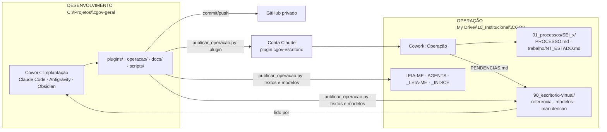

# Plano de Implantação — Escritório Virtual da CGOV/ICMBio

> **Versão:** 3.10 — 05/11/2026 (**Fase 4 em andamento**: 4.1 a 4.4a concluídas; destinos longos encurtados (D26, script v1.1.0); 2 arquivos novos incorporados e pasta CGOV congelada (D27); mapa vigente com 2.833 arquivos e 74 processos; manifesto anterior refeito; zero conflitos e zero caminhos longos). Substitui a v3.0 e a v2 (04/11). A v3 incorpora o **rearranjo dos dois repositórios**: o de desenvolvimento (`C:\Projetos\cgov-geral`) e o operacional (`C:\Users\leand\My Drive\10_Institucional\CGOV`).
> **Responsável:** Coordenador de Governança (CGOV/CGGE/ICMBio)
> **Repositório de desenvolvimento:** `C:\Projetos\cgov-geral` ⇄ GitHub `lpchagas/cgov-geral` (**privado**, confirmado em 05/11), `main` = `46fb7ff` (plano v3.9), conferido no repositório local (`HEAD` = `origin/main`) em 05/11; ⚠️ falta a conferência por `git ls-remote` no PowerShell do Coordenador
> **Repositório operacional:** `C:\Users\leand\My Drive\10_Institucional\CGOV` (Google Drive)
> **Projetos Cowork:** "Escritório CGOV — Implantação" (desenvolvimento) e "Escritório CGOV — Operação" (trabalho da Coordenação)
> **Ferramentas-alvo:** Claude Desktop (Cowork e Code), Google Antigravity, Obsidian, Maestri
> **Método:** análise documental (`engineering:documentation`) e arquitetural com ADRs (`engineering:architecture`)
> **Regra de execução:** uma fase por vez, com confirmação explícita do Coordenador antes de mover, renomear, excluir, reinstalar, fazer *commit* ou *push*.
> **Regra de manutenção:** a cada etapa concluída, este plano é **atualizado integralmente**, conforme a lista de verificação da Seção "Regra de manutenção deste plano" (logo abaixo do sumário).
> **Situação atual:** Fases 1, 2 e 3 ✅ · **Fase 4 🟨** (4.1 a 4.4a ✅ em 05/11: mapa vigente com 2.833 arquivos e 74 processos, manifesto anterior com 2.833 hashes, zero conflitos, zero caminhos longos; **pasta CGOV congelada** até o fim da Fase 4 (D27); **próxima: etapa 4.5, lote a**) · Fase 0 parcial (D4–D8).

---

## Sumário executivo

O Escritório Virtual tem **dois repositórios com papéis distintos**, e a v3 trata os dois como produtos:

| | Repositório de **desenvolvimento** | Repositório **operacional** |
|---|---|---|
| Onde | `C:\Projetos\cgov-geral` (Git ⇄ GitHub privado) | `My Drive\10_Institucional\CGOV` (Google Drive) |
| Para quê | Criar e manter skills, agentes, instruções, documentação e scripts | Produzir o trabalho da CGOV: NTs, análises de processos SEI, normativos, projetos, colegiados |
| Quem usa | Coordenador-mantenedor + projeto Cowork **Implantação** + Claude Code, Antigravity, Obsidian | Coordenador e servidores + projeto Cowork **Operação** |
| Estado em 05/11 | Consolidado no Windows (Fase 1 ✅) | **Desorganizado**: 2.833 arquivos (3,3 GB; 2.827 no inventário inicial, 2.831 na 4.1) em 8 áreas com convenções diferentes; processos divididos entre duas árvores; acervo normativo duplicado; 433 grupos de arquivos idênticos (85 MB redundantes). **Mapa de reorganização arquivo a arquivo aprovado (4.2, revisto na 4.4a), manifesto anterior gerado (4.3) e simulação sem conflitos (4.4); pasta congelada (D27); nada movido ainda** |

**O que a v3 acrescenta:**

1. **Novo arranjo da pasta CGOV** (Seção 5.2): 7 áreas numeradas, mais a infraestrutura (`90_`) e o arquivo (`99_`). Cada processo SEI ganha **uma única pasta**, com subpastas padronizadas e uma ficha `PROCESSO.md`. O acervo normativo passa a ser um só.
2. **Documentação navegável em Markdown** (Seção 5.3): `LEIA-ME.md` e `AGENTS.md` na raiz, `_LEIA-ME.md` e `_INDICE.md` em cada área e `PROCESSO.md` por processo, com metadados em frontmatter que pessoas, agentes de IA e o Obsidian conseguem ler e consultar.
3. **Limpeza controlada** (Seção 5.5): lista de itens desnecessários. Nada é apagado direto: tudo passa por `99_arquivo/_a-excluir_<data>/` e pela sua confirmação.
4. **Dois projetos Cowork novos**: o antigo projeto `cgov-geral-v1` é preservado (as instruções são copiadas) e depois arquivado. Os projetos Cowork por processo passam a ser revistos (ADR-013).
5. **Fases reordenadas** (Seção 6): o desenho dos repositórios (Fase 2) e a reorganização da pasta CGOV (Fase 4) vêm **antes** de atualizar scripts, skills e plugin, que passam a apontar para a estrutura nova.

---

## Regra de manutenção deste plano

Este arquivo é a **fonte de verdade do andamento** da implantação. Uma atualização parcial (por exemplo, marcar só o quadro da Seção 11) deixa o plano contraditório. Por isso, **ao concluir cada etapa ou ao receber cada decisão do Coordenador**, o Claude atualiza o plano **integralmente** e confere **todos** os pontos abaixo antes de declarar a etapa concluída:

| # | Ponto de atualização | O que conferir |
|---|---|---|
| 1 | Cabeçalho | Versão (`3.x`), data, linha **Situação atual** (fases concluídas e próxima fase) |
| 2 | Sumário executivo | Se o estado de algum repositório ou a lógica do plano mudou |
| 3 | Seção 1 (evidências e limitações) | Novas evidências; limitações resolvidas ou novas |
| 4 | Seção 4 (ADRs) | Status de cada ADR (Proposto → Aceito/Rejeitado) |
| 5 | Seção 5 (arquitetura, mapa 5.5, itens 5.6) | Destinos alterados por decisões; remover marcas "a decidir" e ⚠️ já resolvidas |
| 6 | Seção 6.1 (visão geral) | Coluna **Situação** da fase |
| 7 | Seção da fase em execução | Título com o status (`— ✅ concluída (data)` ou `— 🟨 em andamento`), coluna de situação das etapas e um parágrafo **Resultado** com as evidências (commits, hashes, contagens) |
| 8 | Seção 7 (riscos) | Riscos descartados, materializados ou novos |
| 9 | Seção 9 (decisões) | Situação de cada decisão e data |
| 10 | Seção 11 (quadro de acompanhamento) | Status, data e evidência da fase |
| 11 | Apêndices A e B | Se as instruções dos projetos Cowork precisarem mudar, avisar o Coordenador para colar a nova versão |
| 12 | Apêndice G (evolução) e linha final | Registrar a versão nova e o próximo passo |
| 13 | Coerência | Buscar no arquivo por "Proposto", "a decidir", "Pendente" e "⚠️" e confirmar que cada ocorrência ainda é verdadeira |
| 14 | Versionamento | Depois da etapa 3.A.0, fazer *commit* da atualização (`docs(plano): …`) com a confirmação do Coordenador |

A mesma regra está nas instruções do projeto "Escritório CGOV — Implantação" (Apêndice A, regra 8).

---

## 1. Escopo, fontes e limitações

### 1.1. Evidências examinadas

| Fonte | Situação verificada |
|---|---|
| GitHub `lpchagas/cgov-geral` (**privado**, confirmado pelo Coordenador em 05/11) | `main` = `46fb7ff` (05/11, plano v3.9), conferido no repositório local; o `ls-remote` de `b981d66` (v3.8) foi feito no PowerShell do Coordenador. Histórico de 05/11: `46fb7ff` (v3.9), `b981d66` (v3.8), `7f5a324` (v3.7 + `scripts/reorganizar_cgov.py`), `88a5612` (v3.6), `be2f493` (v3.5), `8787e0a` (v3.1), `de0fa54` (v3.3), `6890b63` (`CLAUDE.md` + plano v3.4) e `320007d` (`README.md`, `AGENTS.md`, `docs/fluxos-de-trabalho.md`, D19; mesma mensagem de *commit* do anterior); antes, `8787e0a` (plano v3.1, etapa 3.A.0) e `67957fe` (04/11). *Branch* antigo `claude/cgov-nt-triagem-description-loop-6x6dsc` (`f3628f1`) não incorporado |
| `C:\Projetos\cgov-geral` | Clone limpo; `local\` com ativos resgatados do WSL (63 arquivos conferidos por SHA-256); junções para o Drive; `.env` do Windows; cofre Obsidian aberto (`C:\Projetos\cgov-geral\.obsidian\` ignorado pelo Git desde a v3.3) |
| Projeto Cowork "Escritório CGOV — Implantação" (sessão de 05/11) | Criado no Claude Desktop; instruções = Apêndice A; acesso confirmado às duas pastas: 1ª `C:\Projetos\cgov-geral` e 2ª (temporária) `C:\Users\leand\My Drive\10_Institucional\CGOV`. A sessão leu o plano e aguardou confirmação (teste 3.A.6 aceito pelo Coordenador). Capturas de tela de 05/11: a tela do projeto no Claude Desktop mostra **Instruções**, **Contexto** (2 pastas vinculadas), **Memória** e **Programado**, sem campo de links. O texto do Apêndice A tinha ido para a **descrição**; corrigido pelo Coordenador em 05/11 (as sessões agora recebem a descrição curta de 3.A.2 e as instruções v3.4) |
| Projeto Cowork `cgov-geral-v1` (capturas de 05/11) | 4 pastas vinculadas: `cgov-geral-v1` (`C:\_cowork\cgov-geral-v1`, segundo as instruções), `pgd-agente-icmbio`, `pgd-ocde-icmbio` e `cgge-fgbio-2026`; instruções preservadas em `C:\Projetos\cgov-geral\local\archive\cowork-projetos\cgov-geral-v1_instrucoes_2026-11-05.md` (SHA-256 `ad862755…`) |
| Cópia do WSL `~/projetos/cgov-geral-v1` | Redundante desde 04/11: commit enviado, `.github/` arquivado, `local/` resgatado e conferido (490/490) |
| Pasta CGOV no Drive | Inventário em 05/11 (somente leitura; nomes, contagens, tamanhos e hashes; conteúdo dos documentos **não lido**). Detalhe na Seção 3.4. Recontagem na 4.1: **2.831 arquivos**, todos com SHA-256; pasta não alterada |
| Mapa de reorganização (4.1–4.2; revisto na 4.4a, 05/11) | Vigente: `C:\Projetos\cgov-geral\local\MAPA_REORGANIZACAO_2026-11.csv` (2.860 linhas; 2.833 arquivos; SHA-256 `83db96e21d6146d2…`). Versões anteriores em `C:\Projetos\cgov-geral\local\reorganizacao\conferencia\`: `MAPA_REORGANIZACAO_2026-11_aprovado-4.2.csv` (`5e686e82…`) e `MAPA_REORGANIZACAO_2026-11_D26-2831arq.csv` (`116bf907…`). Resumo `C:\Projetos\cgov-geral\local\MAPA_REORGANIZACAO_2026-11_resumo.md`, decisões `C:\Projetos\cgov-geral\local\reorganizacao\decisoes.csv` (28), apelidos `C:\Projetos\cgov-geral\local\reorganizacao\apelidos.csv` (11) e cache de SHA-256 `C:\Projetos\cgov-geral\local\reorganizacao\cache_sha256.csv`. Para propor apelidos, foi lida só a abertura de 16 PDFs de processo |
| Manifesto anterior e simulação (4.3–4.4, 05/11) | Novo `--planejar` em `C:\Projetos\cgov-geral\local\reorganizacao\conferencia\MAPA_conferencia_2026-11-05.csv`: **idêntico byte a byte** ao mapa aprovado (SHA-256 `5e686e821d30744a…`). Manifesto vigente `C:\Projetos\cgov-geral\local\reorganizacao\manifesto_pre_2026-11.sha256` (2.833 linhas; SHA-256 `8847c5e87a0d5f69…`; refeito na 4.4a), com hashes recalculados do disco (3,53 GB): 2.833/2.833 iguais ao mapa vigente. O manifesto da 4.3 (2.831 linhas, `8a6470cd…`) foi guardado como `conferencia\manifesto_pre_2026-11_2831arq.sha256`: nenhum dos 2.831 hashes mudou. Simulação final: 2.860 operações, zero conflitos e zero avisos de caminho longo. Registros em `C:\Projetos\cgov-geral\local\reorganizacao\conferencia\` |
| Lista de projetos Cowork (captura de tela, 05/11) | 16 projetos, entre eles `cgov-geral-v1` (22/09), `02070.006604 2026-17_Política de Governança_v2`, `02070.007589/2025-35_TCs`, `Sistema Integridade ICMBio`, `pgd-icmbio`, `Painel Estratégico OCDE/ICMBio`, `CGGE_Estrutura` |

### 1.2. Limitações

- ~~Configurações dos projetos Cowork não vistas~~ — **resolvido (05/11, 3.C):** o Coordenador informou que, depois da formatação do computador, as pastas vinculadas aos projetos antigos não existem mais; apontavam, em geral, para projetos de desenvolvimento cujos backups estão em `C:\Users\leand\My Drive\_projetos`, e nenhum aponta para a pasta CGOV atual. Inventário simplificado em `C:\Projetos\cgov-geral\local\archive\cowork-projetos\inventario.md` (D21).
- ~~Compartilhamento da pasta CGOV não verificado~~ — **resolvido (D12, 05/11):** a pasta é de uso exclusivo do Coordenador de Governança.
- ~~Casos não cobertos pelas regras da Seção 5.5~~ — **resolvido (05/11, 4.2):** os 28 `a-decidir` do mapa foram decididos (D22–D24). Continua dependendo do Coordenador a classificação de cada processo em "ativo" ou "encerrado", que entra no frontmatter do `PROCESSO.md` (etapa 4.7).
- As informações sobre o Maestri vêm de catálogos de terceiros (somente macOS); confirmar em `themaestri.app`.
- **O shell do Cowork (máquina virtual Linux) não tem credencial do GitHub:** `git ls-remote`, `git fetch` e `git push` falham ali. Verificações remotas, *commit* e *push* são feitos pelo PowerShell do Coordenador (`C:\Projetos\cgov-geral`), com scripts completos fornecidos pelo Claude (D17, D18).
- ~~Visibilidade do repositório divergente~~ — **resolvido (05/11):** o Coordenador confirmou que o repositório é **privado**; corrigidas as menções a "público" em `C:\Projetos\cgov-geral\CLAUDE.md`, `C:\Projetos\cgov-geral\README.md`, `C:\Projetos\cgov-geral\AGENTS.md` e `C:\Projetos\cgov-geral\docs\fluxos-de-trabalho.md` (D19). As demais desatualizações de `docs\fluxos-de-trabalho.md` (WSL, `~/projetos/cgov-geral-v1`) seguem para a Fase 5.
- O Claude Desktop (05/11) **não tem campo de links** no projeto Cowork; a etapa 3.A.5 foi substituída pela menção ao repositório nas instruções (Apêndice A, "Fontes de verdade").

---

## 2. Análise documental (skill `engineering:documentation`)

### 2.1. Repositório de desenvolvimento (estado de `67957fe`)

| Tipo | Documento | Avaliação | Observação |
|---|---|---|---|
| README | `README.md` | 🟠 | Diz "repositório público"; não tem *quick start* nem mapa |
| Arquitetura e fluxos | `architecture.md`, `CLAUDE.md`, `fluxos-de-trabalho.md` | 🟢 conteúdo / 🟡 atualidade | `fluxos-de-trabalho.md` é o melhor documento, mas descreve WSL, `_acervo-escritorio-virtual/analyses` e repositório público |
| Registro de decisões | `decision-log.md` (27 seções) | 🟢 rico / 🔴 consulta | Pendências no meio (§25); falta registrar a convenção de 07/10 (Seção 3.4) |
| Instruções de operação | `escritorio-cgov.md` | 🟠 | Mapa de tradução de caminhos e inciso V "sem skill" (a `cgov-qcf` existe); será reescrito para a estrutura nova |
| Instruções sobrepostas | `analista-processos-sei.md` (60,9 mil caracteres) | 🔴 | Pendência 20 sem decisão |
| *Onboarding* e catálogo de skills | — | 🔴 Ausentes | — |

### 2.2. Repositório operacional (pasta CGOV)

| Leitor | Necessidade | Situação atual |
|---|---|---|
| Servidor da CGOV | "Onde está o processo X?", "Onde salvo isto?", "Qual a última NT sobre Y?" | **Nenhum documento de orientação** na pasta. Nomes mistos (`CGOV_Processos`, `normative-sources`, `_acervo-escritorio-virtual`, `organizar`). Processos com três padrões de nome (40 com `SEI_`, 30 só com o número, 1 sem número; 44 com espaços) |
| Agente de IA (Cowork) | Saber onde ler e onde gravar sem adivinhar | Depende de um mapa de tradução nas instruções (`local/analyses` → `_acervo…/analyses`), e esse mapa foi superado em 07/10 por uma convenção nova, registrada apenas em arquivos `MOVIDO_PARA.txt` |
| Obsidian / buscas | Metadados consultáveis | Nenhum frontmatter, índice ou ficha |

**Conclusão:** a pasta operacional precisa de uma **camada de navegação** (LEIA-ME, índices e fichas) e de **uma convenção única de nomes**, e não só de pastas novas.

---

## 3. Análise arquitetural (skill `engineering:architecture`)

### 3.1. Requisitos e restrições

| Tipo | Requisito |
|---|---|
| Funcional | Apoiar as 10 atribuições do parágrafo único do Art. 37 (Portaria ICMBio nº 5.592/2025); encontrar qualquer processo, NT ou norma em até dois cliques ou numa consulta à IA |
| Não funcional | **Uma pasta por processo**; **um acervo normativo**; **um lugar** para cada tipo de documento; produção = commit publicado |
| Não funcional | **Sigilo e LGPD**: processos SEI só no Drive, nunca no Git nem no plugin; nenhuma exclusão sem passar pelo arquivo e sem confirmação |
| Não funcional | Legível por analista de negócios **e** por agentes de IA: nomes estáveis, sem espaços nem acentos nas pastas de máquina, Markdown com frontmatter |
| Restrição | Windows; Cowork monta pastas locais; projetos Cowork não são compartilháveis; o Drive sincroniza movimentações para a nuvem (e para quem tiver acesso compartilhado) |
| Restrição | Limites da Anthropic: `description` ≤ 1.024 caracteres; `name` ≤ 64; `SKILL.md` idealmente < 500 linhas |

### 3.2. Arquitetura vigente (síntese)

O desenvolvimento acontece no repositório (agora no Windows) e publica para a operação por `publicar-operacao.sh`: zips das skills e cópia de `docs/` em `_acervo-escritorio-virtual/_referencia`. A operação devolve problemas por `_acervo-escritorio-virtual/manutencao/PENDENCIAS.md`. Esse desenho, da Decisão 27, **é mantido** (ADR-001). O que muda é a organização interna da pasta operacional.

### 3.3. Achados — desenvolvimento

| # | Achado | Impacto |
|---|---|---|
| A1 | Scripts *bash* dependentes do WSL (`ln -s`, `rsync`, caminhos `/mnt/c`) | 🔴 A publicação não roda no Windows |
| A2 | Documentação desatualizada: "público", nome `cgov-geral-v1`, WSL | 🟠 Instruções contraditórias para pessoas e IA |
| A3 | 12 skills em uso sem fonte versionada (resgatadas em `local/installed-reference`) | 🟠 Correção só por reinstalação manual |
| A4 | Três skills instaladas desatualizadas desde 06/10 | 🟠 A operação usa versões com caminhos antigos |
| A5 | Skills citam caminhos literais (`local/analyses/`) | 🟠 Ficam obsoletos com a estrutura nova (ADR-006) |
| A6 | Distribuição em 14 zips com reinstalação individual; espelho `.agents/skills` copiado à mão | 🟡 Deriva |
| A7 | Nenhuma camada de agentes nem de painéis | 🟡 Escopo incompleto |
| A8 | Maestri sem versão Windows (segundo terceiros) | 🟡 |

### 3.4. Achados — pasta operacional CGOV (inventário de 05/11/2026)

| Área atual | Arquivos | Tamanho | Achado |
|---|---|---|---|
| `CGOV_Processos\` | 1.066 | 2,5 GB | 71 pastas com três padrões de nome. Subpastas improvisadas (`_CGOV_NT`, `_referencias`, `_Referências indicadores`, `consulta`, `normativas`, `_Audios`, `Claude outputs`…). Duas pastas para o mesmo processo (`02070.006604 2026-17_Política de Governança` e `…_v2`). Uma pasta **vazia e duplicada** (`SEI_02070 (1).009510_2025_19_AUDIT`). A pasta `SEI_02070.003032_2023-63_Priorização Planos Manejo` concentra 534 arquivos (shapefiles de referência) |
| `_acervo-escritorio-virtual\analyses\` | 1.007 | 517 MB | **Segunda árvore de processos**, com outra convenção de nomes (`02070.001696_2026-31_RADAR` × `SEI_02070.001696_2026_31_Gestao_Riscos`). Quatro pastas contêm só `MOVIDO_PARA.txt`: em **07/10/2026** a operação adotou "NT_ESTADO.md e produtos da NT vivem na pasta do processo" (`CGOV_Processos/<proc>/_CGOV_NT/`), decisão que **não está no repositório**. Também contém `normative-transcription` (928 arquivos, 302 MB, 487 PNG regeneráveis), `_doutorado` (material pessoal), `revisao-prompts-legados` (artefato de desenvolvimento) e `_teste_mv.tmp` (vazio) |
| `normative-sources\` | 110 | 70 MB | Acervo normativo principal (52 PDF + 58 transcrições `.md`) |
| `CGOV_Normativas\` | 17 | 16 MB | **Segundo acervo normativo**: 11 PDFs idênticos aos de `normative-sources` e 6 exclusivos (por exemplo, Portaria nº 1.258/2022) |
| `CGOV_Notas Técnicas\` | 20 | 9 MB | Série de NTs/NIs assinadas (PDF) de 2025–2026 |
| `CGOV_Administrativo\` | 16 | 127 MB | Mistura quatro processos SEI com um tema (Fundo Rio Doce); uma cópia `(1)` idêntica |
| `CGOV_Projetos\` | 18 | 72 MB | Oficinas, eventos e parcerias; versões sucessivas de apresentações |
| `organizar\` | 3 | 0,6 MB | Três versões do Plano de Entregas CGGE (v4, v4.1, v4.2) |
| Raiz | 3 | 5 MB | Transcrição de reunião do CTGRIC (`.docx` + atalho `.gdoc`); `cgov_projetos_trimestre.html` |
| `_acervo…\_tmp\` | 62 | 14 MB | Imagens temporárias de revisão |
| `_acervo…\archive\` | 490 | 13 MB | Inclui `dev-local_2026-11` (cópia de segurança de 04/11) |
| **Total** | **2.827** | **3,3 GB** | **433 grupos de arquivos idênticos (85,5 MB)**, a maioria entre `analyses` e o backup de 04/11, e entre os dois acervos normativos |

---

## 4. Registros de decisão de arquitetura (ADRs)

> Status: **Aceito** (já executado ou aprovado) ou **Proposto** (aprovação pendente na Fase 0; não bloqueia as Fases 3–5). Cada ADR aprovado vira um arquivo em `docs/adr/` na Fase 5.

| ADR | Decisão | Status |
|---|---|---|
| 001 | Preservar a separação desenvolvimento × operação (Decisão 27), o canal `PENDENCIAS.md` e a regra "produção = commit publicado" | Proposto |
| 002 | Desenvolvimento em `C:\Projetos\cgov-geral` (Windows); WSL aposentado | **Aceito** (Fase 1) |
| 003 | Dois projetos Cowork: **Implantação** (pasta do repositório; acesso temporário à pasta CGOV durante a Fase 4) e **Operação** (pasta CGOV; nunca edita o repositório) | **Aceito** (D2, 05/11) |
| 004 | Scripts multiplataforma em Python (`link_acervo.py`, `publicar_operacao.py`, `gerar_indices.py`, `reorganizar_cgov.py`) | Proposto (`reorganizar_cgov.py` já criado na 4.1) |
| 005 | Distribuição como plugin único `cgov-escritorio` (upload de zip; marketplace GitHub só depois de testado e com sincronização automática desligada) | Proposto |
| 006 | Skills neutras quanto a caminho: citam **papéis** ("pasta do processo", "acervo normativo"); os caminhos concretos ficam no `AGENTS.md` de cada repositório | Proposto |
| 007 | Separação de dados: Git só com fonte e documentação sanitizada; processos, normativos e produtos só no Drive | Proposto |
| 008 | Agentes definidos uma vez no plugin; execução no Cowork e no Claude Code; Maestri opcional | Proposto |
| 009 | Obsidian: cofre de desenvolvimento = repositório; cofre de operação = pasta CGOV (opcional, Fase 8) | Proposto |
| 010 | Painéis Power BI em PBIP versionado sem dados; MCP de autoria só no desenvolvimento; Fabric IQ só com autorização da TI | Proposto |
| 011 | Qualidade: evals com `skill-creator`, paridade fonte × instalado, verificação de sanitização | Proposto |
| **012** | **Estrutura do repositório operacional** (Seções 5.2 e 5.3) | **Aceito (05/11)** |
| **013** | **Projetos Cowork por processo passam a ser exceção** | **Aceito (05/11)** |
| **014** | **Exclusão controlada** | **Aceito (05/11)** |

### ADR-012 — Estrutura do repositório operacional

**Contexto.** A pasta CGOV cresceu por acúmulo: duas árvores de processos, dois acervos normativos, três padrões de nome e nenhuma orientação escrita. Em 07/10 a operação já começou a unificar o trabalho da NT na pasta do processo (`_CGOV_NT`), sem registro no repositório.

| Dimensão | A. Manter e só documentar | B. Reorganização completa por **tipo de objeto** (proposta) | C. Reorganização por **inciso do Art. 37** |
|---|---|---|---|
| Encontrar um processo | Duas árvores | Uma pasta por processo, com índice | Processo pode caber em mais de um inciso |
| Esforço | Baixo | Médio (mapa CSV + script + lotes) | Alto |
| Estabilidade dos caminhos | Ruim | **Boa**: o tipo de objeto não muda | Ruim: o enquadramento pode mudar |
| Leitura por IA | Exige mapa de tradução | Convenção única no `AGENTS.md` | Exige classificação prévia |

**Decisão proposta.** **B**. O inciso do Art. 37 entra como **metadado** (`inciso_art37` no `PROCESSO.md`) e **coluna do índice**, e não como pasta. Assim é possível filtrar por inciso sem duplicar arquivos.

### ADR-013 — Projetos Cowork por processo passam a ser exceção

**Contexto.** Há projetos Cowork dedicados a processos (por exemplo, `02070.006604 2026-17_Política de Governança_v2`, `02070.007589/2025-35_TCs`). Com uma pasta por processo, ficha e índice, o projeto **Operação** atende a todos: "trabalhe no processo SEI_02070.020239…".
**Decisão proposta.** Novos processos são trabalhados no projeto Operação. Projetos por processo existentes são revistos na Fase 3.C: os que apontam para pastas que serão movidas são **re-apontados** ou **arquivados** depois que suas instruções forem copiadas para `PROCESSO.md` (seção "Instruções específicas"). Exceção: processos muito longos ou sigilosos podem manter projeto próprio, que aponta para a pasta nova do processo.
**Consequência.** Menos projetos para manter. A memória de cada projeto arquivado se perde, por isso a cópia prévia das instruções.

### ADR-014 — Exclusão controlada

**Decisão proposta.** Nenhum arquivo é excluído diretamente. Os candidatos vão para `99_arquivo/_a-excluir_AAAA-MM-DD/`, com a origem registrada no mapa de reorganização. Depois de **30 dias** sem necessidade de recuperação, você exclui a pasta manualmente. A lixeira do Google Drive ainda guarda os arquivos por mais 30 dias. Arquivos idênticos só são eliminados depois de **conferência por SHA-256**, e sempre preservando uma cópia no destino canônico.

### Demais ADRs — pontos que mudam em relação à v2

- **ADR-003:** os nomes passam a ser **"Escritório CGOV — Implantação"** e **"Escritório CGOV — Operação"**. Durante a Fase 4, o projeto Implantação recebe a pasta CGOV como **segunda pasta, temporariamente**, para executar a reorganização; ela é removida no fim da fase.
- **ADR-006:** a tradução de caminhos sai das instruções do Cowork e passa a ser feita por dois `AGENTS.md`. O do repositório define os caminhos de desenvolvimento; o da raiz da pasta CGOV define os de operação (por exemplo, "estado da NT = `01_processos/<processo>/trabalho/NT_ESTADO.md`").
- **ADR-007:** os destinos passam a ser os da estrutura nova (Seção 5.4).
- **ADR-009:** a pasta CGOV, com LEIA-ME, índices e fichas em Markdown, também pode ser aberta como segundo cofre no Obsidian ("CGOV — Operação"), excluindo as áreas binárias pesadas.

---

## 5. Arquitetura dos repositórios (novo arranjo)

### 5.1. Repositório de desenvolvimento — `C:\Projetos\cgov-geral` (alvo ao fim da Fase 7)

```
cgov-geral/
├── README.md                    ← o que é + quick start + mapa (este quadro)
├── AGENTS.md                    ← regras e caminhos de DESENVOLVIMENTO para agentes (≤ 6 mil caracteres)
├── CLAUDE.md                    ← @AGENTS.md + específicos do Claude Code
├── CONTRIBUTING.md
├── .claude/settings.json        ← proteções (confirmação de commit/push; bloqueio das áreas de operação)
├── plugins/cgov-escritorio/     ← FONTE ÚNICA: skills/, agents/, commands/, plugin.json
├── operacao/                    ← NOVO: fonte da camada de navegação da pasta CGOV
│   ├── LEIA-ME.md · AGENTS.md   ← textos da raiz da pasta CGOV
│   ├── leia-me-areas/           ← _LEIA-ME.md de cada área (01_ … 99_)
│   └── modelos/                 ← PROCESSO.md, NT_ESTADO.md, _INDICE.md, ficha de projeto
├── docs/                        ← arquitetura, fluxos, ADRs, catálogo de skills, decision-log, plano
├── paineis/                     ← PBIP sem dados (Fase 10)
├── scripts/                     ← link_acervo.py, publicar_operacao.py, gerar_indices.py,
│                                   reorganizar_cgov.py, verificar_sanitizacao.py
├── archive/                     ← scripts .sh do WSL, históricos sanitizados
├── .agents/skills ⇢ junção para plugins/cgov-escritorio/skills (ignorado)
├── .obsidian/ · dist/ · .env    ← ignorados
└── local/                       ← ignorado
    ├── processos ⇢ CGOV\01_processos           (antes: analyses)
    ├── normativos ⇢ CGOV\03_normativos          (antes: normative-sources)
    ├── escritorio ⇢ CGOV\90_escritorio-virtual  (antes: acervo-drive)
    └── installed-reference\ archive\ historico\ pilots\
```

**Mudança-chave:** a pasta `operacao/` torna o repositório a **fonte** dos textos de navegação da pasta CGOV (LEIA-ME, AGENTS, `_LEIA-ME` de cada área e modelos). O `publicar_operacao.py` copia esses textos para o Drive, como já faz com `docs/` → `_referencia`. Assim, a camada de navegação também tem versão, revisão e histórico.

### 5.2. Repositório operacional — `My Drive\10_Institucional\CGOV` (alvo ao fim da Fase 4)

```
CGOV\
├── LEIA-ME.md                   porta de entrada: o que é, mapa, "onde salvo?", regras
├── AGENTS.md                    regras e caminhos para agentes de IA
├── 00_entrada\                  caixa de entrada: arquivos novos ainda não classificados
├── 01_processos\                uma pasta por processo SEI
│   ├── _LEIA-ME.md · _INDICE.md
│   └── SEI_02070.020239_2025-64_plano-setorial\
│       ├── PROCESSO.md          ficha do processo (frontmatter + resumo + andamento)
│       ├── documentos-sei\      peças baixadas do SEI (insumos)
│       ├── trabalho\            NT_ESTADO.md, rascunhos, análises (servidor e IA)
│       ├── referencias\         apoio: planilhas, dados, mapas, normas específicas, áudios
│       └── produtos\            versões finais enviadas ao SEI (antes da assinatura)
├── 02_notas-tecnicas\           série oficial de NTs e Informações assinadas (PDF)
│   ├── _LEIA-ME.md · _INDICE.md (registro: nº/ano, data, doc. SEI, processo, tema, inciso)
│   └── 2025\ · 2026\
├── 03_normativos\               acervo normativo único: PDF + transcrição .md, mesmo nome-base
│   ├── _LEIA-ME.md · _INDICE.md (catálogo com vigência)
│   └── revogados\
├── 04_colegiados\               CTGRIC, Conselho de Governança, CIG, CTGD: pautas, atas, transcrições
│   └── ctgric\ · conselho-governanca\ · cig\ · ctgd\
├── 05_projetos\                 projetos, oficinas, eventos e parcerias que não são um processo SEI
│   └── AAAA-MM_apelido\  (+ PROJETO.md)
├── 06_gestao-da-coordenacao\    plano de entregas/PGD da CGOV, planejamento, acompanhamento
├── 90_escritorio-virtual\       infraestrutura do Escritório — não editar à mão
│   ├── _LEIA-ME.md
│   ├── referencia\              documentação publicada do repositório (somente leitura)
│   ├── modelos\                 modelos publicados (PROCESSO.md, NT_ESTADO.md…)
│   ├── manutencao\              PENDENCIAS.md · MAPA_REORGANIZACAO_2026-11.csv
│   └── transcricoes\            trabalho de OCR de normativos (intermediário)
└── 99_arquivo\                  processos encerrados, versões superadas, backups
    ├── processos-encerrados\ · versoes-anteriores\ · escritorio-virtual\
    └── _a-excluir_AAAA-MM-DD\   quarentena antes da exclusão (ADR-014)
```

**Mapa de finalidades** (vai para o `LEIA-ME.md` da raiz):

| Pasta | Finalidade | Entra aqui | Não entra aqui | Quem alimenta |
|---|---|---|---|---|
| `00_entrada` | Triagem | Downloads, anexos, arquivos recebidos sem destino claro | Nada fica aqui mais de uma semana | Todos; a IA propõe o destino |
| `01_processos` | Trabalho por processo SEI | Tudo o que pertence a um processo com número SEI | NT já assinada (vai para `02`) | Servidores e IA |
| `02_notas-tecnicas` | Série oficial | NTs e NIs **assinadas** da CGOV, uma vez | Rascunhos | Responsável pela NT, após a assinatura |
| `03_normativos` | Base normativa | Leis, decretos, portarias, INs (PDF + `.md`) | Minutas em discussão (ficam no processo) | Curadoria (agente `curador-acervo`) |
| `04_colegiados` | Secretaria de colegiados | Pautas, atas, listas, transcrições de reuniões | Processos de criação ou alteração do colegiado (vão para `01`) | Secretaria-executiva |
| `05_projetos` | Iniciativas sem processo | Oficinas, eventos, apresentações, parcerias | Material de processo SEI | Responsável pelo projeto |
| `06_gestao-da-coordenacao` | Gestão interna da CGOV | Plano de entregas, PGD da equipe, planejamento | Processos | Coordenador |
| `90_escritorio-virtual` | Infraestrutura de IA | Gerado pela publicação do repositório e pelos agentes | Trabalho de processo | Publicação automática |
| `99_arquivo` | Memória | Encerrados, versões superadas | Material em uso | Triagem periódica |

### 5.3. Estrutura de documentos Markdown (navegação para pessoas e IA)

| Documento | Onde | Para quem | Conteúdo | Mantido por |
|---|---|---|---|---|
| `LEIA-ME.md` | Raiz | Servidores (e IA) | O que é o Escritório; mapa de pastas (5.2); "Tenho X, onde salvo?"; convenção de nomes; regras de LGPD; como pedir ajuda ao Claude | Repositório (`operacao/`), publicado |
| `AGENTS.md` | Raiz | Agentes de IA | Caminhos canônicos (onde ler, onde gravar, onde nunca gravar); convenções de nomes; obrigação de atualizar `PROCESSO.md` e índices; uso de `00_entrada` | Repositório, publicado |
| `_LEIA-ME.md` | Cada área | Ambos | Finalidade, o que entra e o que não entra, padrão de nome, exemplo | Repositório, publicado |
| `_INDICE.md` | `01`, `02`, `03`, `04`, `05` | Ambos | Tabela gerada a partir dos frontmatters (processo, situação, inciso, última atualização…) | `gerar_indices.py` / comando `/cgov-escritorio:atualizar-indices` |
| `PROCESSO.md` | Cada processo | Ambos | Frontmatter (abaixo) + objeto, histórico, produtos, links para NTs, "instruções específicas" | Servidor responsável + IA |
| `NT_ESTADO.md` | `trabalho/` de cada processo | IA (suíte `cgov-nt`) | Estado e roteiro da NT | Skills `cgov-nt-01` a `07` |
| `PROJETO.md` | Cada projeto em `05` | Ambos | Frontmatter semelhante ao do processo | Responsável |

**Frontmatter padrão do `PROCESSO.md`** (modelo completo no Apêndice F):

```yaml
---
tipo: processo
sei: "02070.020239/2025-64"
apelido: plano-setorial
titulo: "Plano Setorial … (ECOA ICMBio)"
inciso_art37: [II]
situacao: em-andamento        # em-andamento | aguardando-terceiros | concluido | arquivado
unidade_demandante: "…"
aberto_em: 2025-…
atualizado_em: 2026-11-05
notas_tecnicas: ["NT 31/2026"]
cowork_projeto: ""            # preencher só se houver projeto Cowork dedicado (ADR-013)
---
```

Sem nomes nem matrículas de servidores no frontmatter (LGPD). Quando necessário, registra-se o **papel** ("responsável: coordenação").

### 5.4. Convenção de nomes

| Objeto | Padrão | Exemplo |
|---|---|---|
| Pasta de processo | `SEI_<órgão>.<número>_<ano>-<dígito>_<apelido>` (apelido em minúsculas, com hífen, sem acento) | `SEI_02070.020239_2025-64_plano-setorial` |
| Subpastas de processo | Fixas: `documentos-sei`, `trabalho`, `referencias`, `produtos` | — |
| Documento baixado do SEI | `AAAAMMDD_SEI_<nº documento>_<tipo>_<descrição>.pdf` (padrão já usado em parte do acervo) | `20260402_SEI_023188992_Parecer_PFE_101-2026.pdf` |
| NT assinada | `AAAA\NT_<nº>-<ano>_SEI_<nº documento>_<tema>.pdf` | `2026\NT_13-2026_SEI_023115133_pfe-plano-setorial.pdf` |
| Normativo | `AAAAMMDD_<Tipo> <nº>_<tema>.pdf` e `.md` com o mesmo nome-base (padrão já usado em `normative-sources`) | `20251211_Portaria ICMBio 5.592_Regimento Interno.pdf` |
| Projeto | `AAAA-MM_<apelido>` | `2026-10_oficina-pgd-gr2-fortaleza` |
| Versões | Sufixo `_v1`, `_v2`…; ao concluir, as anteriores vão para `99_arquivo/versoes-anteriores/` | — |

As pastas de máquina (processos, projetos) evitam espaços e acentos. Os nomes de arquivos de documentos podem manter acentos, porque o Drive e o Cowork lidam bem com eles.

### 5.5. Mapa de reorganização (nível de pasta; o detalhamento arquivo a arquivo é gerado na Fase 4.1)

| Origem atual | Destino | Observação |
|---|---|---|
| `CGOV_Processos\<71 pastas>` (72 nomes no mapa da 4.1, contando a pasta vazia duplicada) | `01_processos\SEI_<…>_<apelido>\` | Renomear para a convenção. Arquivos soltos → `documentos-sei\`; `_CGOV_NT\` e `Claude outputs\` → `trabalho\`; `_referencias`, `_Referências indicadores`, `consulta`, `normativas`, `_Audios`, `Guia de Gestão`, `Fichas Indicadores`, `Apresentações`, `Oficina`, `avaliacao_pgd` → `referencias\` (ou `trabalho\`, conforme o caso, no mapa CSV) |
| `CGOV_Processos\02070.006604 2026-17_Política de Governança` + `…_v2` | Uma pasta `SEI_02070.006604_2026-17_politica-governanca\` | **Fundir** (D10); arquivos de mesmo nome da v2 em `trabalho\v2\` |
| `CGOV_Processos\ADPF` (sem número) | `99_arquivo\processos-encerrados\ADPF\` | Projeto antigo sem número SEI rastreável (D11) |
| `CGOV_Administrativo\SEI_*` (4) | `01_processos\` | — |
| `CGOV_Administrativo\CGOV_Fundo Rio Doce` | `05_projetos\fundo-rio-doce\` (ou processo, se houver número SEI) | — |
| `_acervo…\analyses\<pastas de processo>` (8) | `01_processos\<processo>\trabalho\` | Correspondência pelo número SEI (por exemplo, `SEI_02070.012181_2026_66_PGRO`, `…014637…OCDE`, `…005395…Comite-Gestor`, `Integra+`) |
| `_acervo…\analyses\` com `MOVIDO_PARA.txt` (4) | `99_arquivo\_a-excluir_…\` | O conteúdo já está nas pastas `_CGOV_NT`; a movimentação fica registrada no CSV |
| `_acervo…\analyses\Indicadores_ocde` | `01_processos\SEI_02070.014637_2025-41_ocde-pgd\trabalho\` | — |
| `_acervo…\analyses\_Impacto Regulatório_Plano de Manejo` | Nova pasta `01_processos\SEI_02070.017019_2026-34_air-planos-manejo\` (processo da NT 27/2026): `.md` e versões → `trabalho\`; `SEI_023982292_Nota_Tecnica_27_final.pdf` → `02_notas-tecnicas\2026\` | D11. Processo **SEI nº 02070.017019/2026-34**, confirmado pelo Coordenador em 05/11 |
| `_acervo…\analyses\SEI__Reunioes-CIG` | `04_colegiados\cig\` | — |
| `_acervo…\analyses\normative-transcription` | `90_escritorio-virtual\transcricoes\` | 487 PNG regeneráveis → candidatos a `_a-excluir` |
| `_acervo…\analyses\revisao-prompts-legados-2026-08-28` | `99_arquivo\escritorio-virtual\` | Artefato de desenvolvimento |
| `_acervo…\analyses\_doutorado` | `My Drive\_projetos\05_privado\_doutorado\` (fora da pasta institucional) | D14 |
| `_acervo…\_referencia\` | `90_escritorio-virtual\referencia\` | — |
| `_acervo…\manutencao\` | `90_escritorio-virtual\manutencao\` | — |
| `_acervo…\archive\` | `99_arquivo\escritorio-virtual\` | — |
| `_acervo…\_tmp\` | `99_arquivo\_a-excluir_…\` | Temporários |
| `normative-sources\` (110) | `03_normativos\` | A PGE (Portaria nº 768/2020, revogada) vai para `revogados\` |
| `CGOV_Normativas\` (17) | 6 exclusivos → `03_normativos\`; 11 idênticos → `_a-excluir` | Conferência por SHA-256 |
| `CGOV_Notas Técnicas\` (20) | `02_notas-tecnicas\2025\` e `2026\` | Manter os nomes originais na primeira etapa; padronizar depois, com o índice |
| `CGOV_Projetos\` | `05_projetos\<AAAA-MM_apelido>\`; Plano de Entregas CGOV (GIZ) → `06_gestao-da-coordenacao\` | Versões `v1`–`v3` das apresentações → `99_arquivo\versoes-anteriores\` (D15) |
| `organizar\` (3 versões do Plano de Entregas CGGE) | `06_gestao-da-coordenacao\plano-de-entregas\` (versão vigente) + anteriores em `99_arquivo` | Qual é a vigente: D15 |
| `CGOV_Processos\SEI_02070.020064_2025_95_Planos de Manejo` + `SEI_SEI_02070.020064_2025_95_IN Planos Manejo` | Uma pasta `01_processos\SEI_02070.020064_2025-95_planos-manejo\`; conteúdo da segunda em `trabalho\in-planos-manejo\` | **Fundir** (D22, como D10) |
| `_acervo…\analyses\<processo>\` — PDFs baixados do SEI | `01_processos\<processo>\documentos-sei\` (demais arquivos em `trabalho\`; PDFs de apoio em `referencias\`) | Refinamento da 4.1, coerente com as subpastas da Seção 5.2 |
| `normative-sources\Minuta_Portaria_*_Gestao_Riscos_*.md` (2) | `01_processos\SEI_02070.001696_2026-31_gestao-riscos\trabalho\` | Minutas ficam no processo (D23) |
| `CGOV_Normativas\` Portarias ICMBio 4.101/2023 e 1.164/2025 (mesmo nome, conteúdo diferente) | `99_arquivo\versoes-anteriores\normativos\`; a versão de `normative-sources` fica em `03_normativos\` | D22 |
| `CGOV_Normativas\SEI_023125903_Minuta_de_Portaria.pdf` | `01_processos\SEI_02070.006604_2026-17_politica-governanca\trabalho\` | D22 |
| `CGOV_Notas Técnicas\08_NT_16-2025_…_Retirar.pdf` · `SEI_023512415_Nota_Tecnica_20.pdf` | `99_arquivo\versoes-anteriores\notas-tecnicas\` · `02_notas-tecnicas\2026\` | D22 |
| `CGOV_Projetos\` soltos: 2 do PPI e Ajuda-Memória MMA · `Matriz de impacto.docx` e imagem | `01_processos\SEI_02070.011203_2025-90_parcerias-inovacao\referencias\` · `00_entrada\` | D22 |
| 16 pastas de processo sem apelido | 11 com apelido proposto pelo assunto do processo; 5 só com o número | D24 |
| Raiz: `21_CTGRIC_Transcrição de Reunião.docx` + `.gdoc` | `04_colegiados\ctgric\` | Mover o par juntos |
| Raiz: `cgov_projetos_trimestre.html` | `06_gestao-da-coordenacao\` | — |

### 5.6. Itens desnecessários identificados (vão para a quarentena `_a-excluir`, nunca para exclusão direta)

| Item | Motivo | Evidência |
|---|---|---|
| `CGOV_Processos\SEI_02070 (1).009510_2025_19_AUDIT\` | Pasta vazia, duplicada | 0 arquivos |
| `…\Relatorio_de_Status…08ABR2024 (1).xlsx` | Cópia idêntica | SHA-256 igual ao original |
| ~~`…\SEI_022838998_Nota_Tecnica_3_2026 (1).pdf`~~ | **Não** é cópia idêntica (SHA-256 diferente, 4.1) | Mantida como `…_Nota_Tecnica_3_2026_v2.pdf` (D22); não vai para a quarentena |
| `_acervo…\analyses\_teste_mv.tmp` | Arquivo de teste vazio | 0 bytes |
| 4 pastas só com `MOVIDO_PARA.txt` | Aviso de movimentação já executada | Conteúdo em `_CGOV_NT` |
| 13 arquivos de `CGOV_Normativas` | Idênticos a arquivos de `normative-sources` ou a cópias já presentes em processos | SHA-256 (4.1) |
| 3 arquivos vazios em processos (`New Documento de Texto.txt`, `Links uteis.txt`, `02070.017019_2026-34.txt`) e 2 pastas vazias (`_Audios`, `Serie_ANO`) | Sem conteúdo | 0 bytes (4.1) |
| `_acervo…\_tmp\pdfs\` (62) | Imagens temporárias de revisão | Pasta `_tmp` |
| 487 PNG de `normative-transcription` | Páginas renderizadas, regeneráveis a partir dos PDFs | Extensão e local |
| `archive\dev-local_2026-11\_backup\` (427) | Na maioria idênticos às análises atuais (346 grupos) | **Manter** até a Fase 4 terminar; reavaliar depois |
| Versões antigas de apresentações e planilhas | Superadas | Não excluir: ir para `99_arquivo\versoes-anteriores\` |

Economia estimada sem perda de informação: cerca de **400 MB** e **1.000 arquivos**. Os 85 MB de duplicatas, os 302 MB do OCR intermediário e os temporários ficam fora da área de trabalho.

**Resultado do mapa da 4.1–4.2:** a quarentena recebe **584 arquivos (322,5 MB) e 3 pastas vazias**, e o restante dos ~400 MB previstos depende da reavaliação do backup `dev-local_2026-11` (490 arquivos), que fica em `99_arquivo\escritorio-virtual\` até o fim da Fase 4.

### 5.7. Fluxo integrado dos dois repositórios



---

## 6. Plano de implantação em fases

### 6.1. Visão geral

| Fase | Nome | Resultado | Executa | Estimativa* | Situação |
|---|---|---|---|---|---|
| 0 | Decisões | ADRs e decisões D1–D27 respondidos | Coordenador | 1 dia | 🟨 Parcial: D1–D3 e D9–D27 respondidas; D4–D8 e ADR-001, 004–011 pendentes |
| 1 | Consolidação do desenvolvimento no Windows | **✅ Concluída em 04/11** | — | — | ✅ 04/11/2026 |
| 2 | **Arquitetura dos repositórios** | Arranjo das Seções 5.1–5.6 aprovado (ADR-012/013/014; D10–D16) | Coordenador | 1 dia | ✅ 05/11/2026 |
| 3 | Projetos Cowork | "Implantação" criado; `cgov-geral-v1` preservado e arquivado; vínculos dos demais projetos inventariados | Coordenador (interface) + Claude | ½ dia | ✅ 05/11/2026 |
| 4 | **Reorganização da pasta CGOV** | Estrutura nova, documentos de navegação, fichas, índices; projeto "Operação" criado | Claude (scripts e textos) + Coordenador (aprovações e execução) | 3–5 dias | 🟨 Em andamento: 4.1 a 4.4a ✅ (05/11); próxima 4.5 (lote a) |
| 5 | Atualização do repositório de desenvolvimento | Scripts em Python, pasta `operacao/`, documentação corrigida, junções e `.env` com os caminhos novos | Claude, com portões | 2–3 dias | ⬜ |
| 6 | Portfólio de skills | 12 skills promovidas a fonte; caminhos neutros; nova skill `cgov-gestao-acervo`; desatualizadas reinstaladas | Claude + Coordenador | 3–5 dias | ⬜ |
| 7 | Plugin `cgov-escritorio` | Um zip por versão; 26 skills avulsas substituídas; comandos de acervo | Coordenador + Claude | 1–2 dias | ⬜ |
| 8 | Multiplataforma e aposentadoria do WSL | Claude Code, Antigravity, Codex e Obsidian (dois cofres) | Coordenador + Claude | 1 dia | ⬜ |
| 9 | Agentes e orquestração | 5 agentes + comandos; cenário Maestri | Claude + Coordenador | 3–5 dias | ⬜ |
| 10 | Painéis Power BI | Catálogo, PBIP versionado, skills de painel | Coordenador + Claude | 3–5 dias | ⬜ |
| 11 | Qualidade e pilotos | Evals de todas as skills; 2 pilotos reais | Coordenador + Claude | 1–2 semanas | ⬜ |
| 12 | Disseminação e governança | Guia do servidor, capacitação, ciclo de versões | Coordenador | contínuo | ⬜ |

\* Referência para trabalho em tempo parcial.

---

### Fase 0 — Decisões — 🟨 parcial

| Etapa | Ação | Situação |
|---|---|---|
| 0.1 | Aprovar os ADRs (Seção 4) | ADR-002, 003, 012, 013 e 014 aceitos; demais pendentes |
| 0.2 | Responder às decisões da Seção 9 | D1–D3 e D9–D27 respondidas (04–05/11); D4–D8 pendentes, sem bloquear as Fases 3–5 |
| 0.3 | Confirmar em `themaestri.app` se existe versão Windows (D8) | Pendente |
| 0.4 | Pré-requisitos: `git` ✅, `python --version` (≥ 3.11), `node --version` (LTS), Claude Desktop, Antigravity, Obsidian | Git conferido em 04/11 |

---

### Fase 1 — Consolidação do desenvolvimento no Windows — ✅ concluída (04/11/2026)

Resumo do que foi feito: remoto do WSL corrigido para `cgov-geral`; `.gitignore` descartado; `.github/` (Copilot) arquivado; *push* `4960e11..67957fe`; clone em `C:\Projetos\cgov-geral` (`autocrlf=false`); manifesto `local/_manifesto_wsl_20261104.sha256` (490 arquivos), com 63/63 conferidos em `local\` e 488/488 no Drive (`_acervo…\archive\dev-local_2026-11`); junções para o Drive; `.env` do Windows. As junções e o `.env` serão **refeitos na Fase 5** para os caminhos novos.

---

### Fase 2 — Arquitetura dos repositórios (aprovação) — ✅ concluída (05/11/2026)

**Objetivo:** aprovar o arranjo **antes** de mexer em qualquer arquivo. Esta fase é só de leitura e decisão.

| Etapa | Ação | Entregável | Situação |
|---|---|---|---|
| 2.1 | Revisar a Seção 5.1 (desenvolvimento) e a Seção 5.2 (operação), com o mapa de finalidades | Aprovação ou ajustes | ✅ Aceito sem ajustes |
| 2.2 | Revisar a convenção de nomes (5.4) e o frontmatter do `PROCESSO.md` (5.3 e Apêndice F) | Aprovação ou ajustes | ✅ Aceito sem ajustes |
| 2.3 | Revisar o mapa de reorganização (5.5) e decidir os itens "a decidir" | D10, D11, D14, D15 | ✅ Respondidas |
| 2.4 | Revisar a lista de itens desnecessários (5.6) e a política de quarentena (ADR-014) | D16 | ✅ Respondida |
| 2.5 | Responder D12 (compartilhamento da pasta CGOV) e D13 (projetos Cowork por processo) | Respostas | ✅ Respondidas |
| 2.6 | Revisar os rascunhos do `LEIA-ME.md` da raiz (Apêndice E) e dos modelos (Apêndice F) | Aprovação ou ajustes | ✅ Aceito sem ajustes |

**Critério de aceite:** ADR-012, 013 e 014 aprovados; D10–D16 respondidas. **Portão:** a Fase 4 só começa com esta fase concluída.

**Resultado (05/11/2026):** arranjo das Seções 5.1–5.6 aceito sem ajustes; ADR-012, 013 e 014 aceitos. Decisões incorporadas ao mapa 5.5: D10 fundir as duas pastas da Política de Governança; D11 ADPF para `99_arquivo\processos-encerrados\` e Impacto Regulatório para o processo SEI nº 02070.017019/2026-34 (NT 27/2026); D12 pasta de uso exclusivo do Coordenador (risco de compartilhamento descartado); D13–D16 conforme as recomendações. Portão da Fase 4 liberado.

---

### Fase 3 — Projetos Cowork — ✅ concluída (05/11/2026)

> Documentação oficial ("Organize work with projects"): um projeto reúne descrição, pastas locais, instruções, links (⚠️ campo ausente no Claude Desktop em 05/11; ver 1.2), projetos do Chat vinculados e memória própria; fica no computador e não é compartilhado. Criação: **Projects → + → Start from scratch / Import a project / Use an existing folder**. **Arquivar** apaga nome, instruções, links e memória do projeto, mas **não toca nas pastas**. Arquivos arrastados vão para a **primeira pasta**.

#### 3.A — Criar "Escritório CGOV — Implantação" — ✅ concluída (05/11/2026)

> **Onde criar:** no **aplicativo Claude Desktop, aba Cowork**, e **não** no navegador (claude.ai). Projetos Cowork com pastas locais vivem no computador; a página web de projetos só anexa arquivos. A aba **Code** serve para sessões de terminal no repositório (por exemplo, *commit* e testes de plugin) e não substitui o projeto Cowork.
> **Como vincular pastas:** em **Projects → + → Use an existing folder**, escolha a pasta principal. As demais pastas são adicionadas nas configurações do projeto ou **arrastando a pasta do Explorador de Arquivos para o projeto** (pastas arrastadas viram pastas adicionais do projeto; arquivos arrastados são copiados para a primeira pasta). **Não** coloque caminhos na descrição: a descrição só orienta o Dispatch e não dá acesso a nada.

| Etapa | Onde                                      | O que preencher                                                                                                                                                                                                                                                                                                                                        | Situação |
| ----- | ----------------------------------------- | ------------------------------------------------------------------------------------------------------------------------------------------------------------------------------------------------------------------------------------------------------------------------------------------------------------------------------------------------------ | --- |
| 3.A.0 | PowerShell em `C:\Projetos\cgov-geral`    | **Versionar este plano** antes de tudo, para protegê-lo e registrar cada atualização: `git add cgov-geral-plano-implantacao.md` → `git commit -m "docs(plano): plano de implantação v3.1"` → `git push` (com a sua confirmação). O plano continua na raiz até a etapa 5.9                                                                              | ✅ 05/11 — `8787e0a` (v3.1); v3.2 e v3.3 em `de0fa54` |
| 3.A.1 | **Projects → + → Use an existing folder** | `C:\Projetos\cgov-geral` (primeira pasta)                                                                                                                                                                                                                                                                                                              | ✅ 05/11 |
| 3.A.2 | Nome e descrição                          | **Nome:** `Escritório CGOV — Implantação` · **Descrição:** *"Desenvolvimento e implantação do Escritório Virtual da CGOV/ICMBio: skills, agentes, documentação, scripts e painéis do repositório cgov-geral, e reorganização da pasta operacional CGOV. Não é usado para Notas Técnicas nem análises de processos."*                                   | ✅ 05/11 |
| 3.A.3 | **Folders**                               | Acrescentar `C:\Users\leand\My Drive\10_Institucional\CGOV` como **segunda pasta, temporária**, para a Fase 4 (pelas configurações do projeto ou arrastando a pasta do Explorador para o projeto). Ela é removida no fim da Fase 4 (etapa 4.10). Conferência: numa sessão do projeto, pergunte "Quais pastas você tem acesso?"; devem aparecer as duas | ✅ 05/11 — duas pastas confirmadas pelo Claude |
| 3.A.4 | **Instructions**                          | Apêndice A                                                                                                                                                                                                                                                                                                                                             | ✅ 05/11 — instruções v3.4 em **Instruções** e descrição curta restaurada (correção da colagem inicial na descrição) |
| 3.A.5 | **Links**                                 | `https://github.com/lpchagas/cgov-geral`                                                                                                                                                                                                                                                                                                               | ➖ Campo inexistente no Claude Desktop; link incluído no Apêndice A (Fontes de verdade) |
| 3.A.6 | Teste                                     | Nova sessão: *"Leia a Fase 3.B do plano e liste o que fará, sem executar nada."* A resposta deve citar o plano e pedir confirmação                                                                                                                                                                                                                     | ✅ 05/11 — sessão de 05/11 aceita como teste |

**Resultado 3.A (05/11/2026):** plano versionado (`8787e0a`, etapa 3.A.0); projeto "Escritório CGOV — Implantação" criado no Claude Desktop, com as pastas `C:\Projetos\cgov-geral` (1ª) e `C:\Users\leand\My Drive\10_Institucional\CGOV` (2ª, temporária) confirmadas pelo Claude; teste 3.A.6 aceito pelo Coordenador. Ajustes desta etapa (v3.3): `.obsidian/` incluído no `C:\Projetos\cgov-geral\.gitignore` (D18); regras de interação 9–12 no Apêndice A (D17). *Commit* `de0fa54` (v3.2 + v3.3) enviado e conferido por `git ls-remote` (05/11). **Correção (v3.4):** as capturas mostraram que o campo **Instruções** estava vazio e que o texto do Apêndice A tinha ido para a **descrição**; não há campo de links no Claude Desktop. Corrigido pelo Coordenador em 05/11: Apêndice A v3.4 em **Instruções** e descrição curta restaurada; conferido pelo Claude no contexto da sessão.

#### 3.B — Preservar e arquivar o projeto antigo `cgov-geral-v1` — ✅ concluída (05/11/2026)

Não exclua esse projeto e não o reaproveite. Ele é de 22/09, anterior à separação dos fluxos e à mudança para o Windows, e pode ter instruções e memória que valem guardar.

1. Abrir as configurações do `cgov-geral-v1` e anotar a **pasta vinculada**. — ✅ 05/11: 4 pastas (`cgov-geral-v1`, `pgd-agente-icmbio`, `pgd-ocde-icmbio`, `cgge-fgbio-2026`); caminho completo conhecido só da primeira (`C:\_cowork\cgov-geral-v1`).
2. Copiar o texto de **Instructions** para `C:\Projetos\cgov-geral\local\archive\cowork-projetos\cgov-geral-v1_instrucoes_2026-11-05.md`. A pasta `local\` é ignorada pelo Git. — ✅ 05/11: cópia literal gravada e conferida por SHA-256 (`ad862755…`); `git check-ignore` confirma que fica fora do Git.
3. Se o projeto tiver memória relevante, abrir uma sessão nele e pedir: *"Resuma o que está na memória deste projeto"*. Salvar o resumo no mesmo arquivo. Alternativa mais simples: claude.ai ou Claude Desktop → projeto → **Memória → Ver**, e copiar o texto. — ✅ 05/11: memória **não preservada** por decisão do Coordenador (D20): trata só de uma análise antiga, sem relação com a implantação; registrado no arquivo da etapa 2.
4. **Arquivar** o projeto (menu do projeto → **Archive**) só **depois** de o projeto Implantação passar no teste 3.A.6 e de a 3.B.3 estar concluída. — ✅ 05/11: projeto arquivado pelo Coordenador. Arquivar apaga nome, instruções e memória do projeto, mas não toca em pastas; as instruções já estão preservadas.

**Resultado 3.B (05/11/2026):** instruções e as 4 pastas vinculadas do `cgov-geral-v1` preservadas em `C:\Projetos\cgov-geral\local\archive\cowork-projetos\cgov-geral-v1_instrucoes_2026-11-05.md`; memória não preservada (D20); projeto arquivado pelo Coordenador.

#### 3.C — Inventariar os vínculos dos demais projetos Cowork — ✅ concluída (05/11/2026)

Para cada projeto da lista que possa apontar para a pasta CGOV (por exemplo, `02070.006604 2026-17_Política de Governança_v2`, `02070.007589/2025-35_TCs`, `Sistema Integridade ICMBio`, `Painel Estratégico OCDE/ICMBio`, `CGGE_Estrutura`, `oficina-planejamento-GR2`), e para as pastas extras do `cgov-geral-v1` (`pgd-agente-icmbio`, `pgd-ocde-icmbio`, `cgge-fgbio-2026`), registre num quadro em `C:\Projetos\cgov-geral\local\archive\cowork-projetos\inventario.md`: **nome**, **pastas vinculadas** e **se a pasta será movida na Fase 4**. Esse quadro orienta a etapa 4.9 (re-apontar ou arquivar, conforme o ADR-013).

**Resultado 3.C (05/11/2026):** ✅ inventário simplificado (D21) em `C:\Projetos\cgov-geral\local\archive\cowork-projetos\inventario.md` (SHA-256 `d43f798c…`): 13 projetos listados; segundo o Coordenador, os vínculos dos projetos antigos não existem mais desde a formatação do computador (backups em `C:\Users\leand\My Drive\_projetos`) e nenhum aponta para a pasta CGOV atual. **Consequência:** a Fase 4 não quebra vínculo de projeto antigo; a etapa 4.9 passa a decidir só se cada projeto é re-apontado ou arquivado (ADR-013). ⚠️ A lista vem de capturas de tela e pode não ter os 16 projetos.

**Resultado da Fase 3 (05/11/2026):** projeto "Escritório CGOV — Implantação" criado no Claude Desktop, com as duas pastas, as instruções v3.4 e a descrição curta, e testado (3.A.6); `cgov-geral-v1` preservado e arquivado (3.B); vínculos dos demais projetos inventariados (3.C, D21). *Commits* de 05/11: `8787e0a`, `de0fa54`, `6890b63`, `320007d` e `be2f493`, todos conferidos por `git ls-remote`. Decisões D17–D21. **Portão:** a Fase 4 pode começar.

---

### Fase 4 — Reorganização da pasta CGOV — 🟨 em andamento (4.1 a 4.4a ✅ em 05/11/2026)

> Executada no projeto Implantação, com a pasta CGOV vinculada temporariamente. O Google Drive para desktop deve estar **em execução** e com a pasta **"Disponível offline"**, para que as movimentações sejam sincronizadas como movimentações (e não como exclusão + criação). Nenhuma etapa exclui arquivos (ADR-014).

| Etapa | Ação | Quem | Aceite | Situação |
|---|---|---|---|---|
| 4.1 | **Gerar o mapa de reorganização arquivo a arquivo** (`90_…\manutencao\MAPA_REORGANIZACAO_2026-11.csv`, rascunho inicialmente em `local\`), com as colunas `origem`, `destino`, `acao` (mover / renomear / quarentena / a-decidir), `sha256`, `motivo`. Aplica as regras da Seção 5.5 e marca os ambíguos como `a-decidir` | Claude (script `reorganizar_cgov.py --planejar`, somente leitura) | CSV cobre 100% dos arquivos (2.831 na 4.1) | ✅ 05/11 |
| 4.2 | **Revisão do mapa** pelo Coordenador: resolver os `a-decidir` e conferir os nomes de pasta dos processos (73 no mapa) | Coordenador | Zero linhas `a-decidir` | ✅ 05/11 |
| 4.3 | **Manifesto anterior**: SHA-256 de todos os arquivos (`manifesto_pre_2026-11.sha256`) | Claude | Arquivo gerado | ✅ 05/11 |
| 4.4 | **Simulação**: `reorganizar_cgov.py --simular` lista cada operação e conflitos de nome, sem mover nada | Claude | Zero conflitos | ✅ 05/11 |
| 4.4a | **Encurtar os destinos longos** (D26): regra de destino mais curta em `99_arquivo` para os 312 destinos acima de 259 caracteres (lotes f e g); novo `--planejar`, conferência de que só mudam linhas dos lotes f e g, nova `--simular` e aprovação do Coordenador. Deve ser feita **antes do lote a**, porque o `--planejar` só reproduz o mapa sobre a árvore original | Claude (script) + Coordenador (aprovação) | Zero destinos acima de 259 caracteres; linhas dos lotes a–e inalteradas | ✅ 05/11 |
| 4.5 | **Execução em lotes**, cada um com confirmação e conferência do sincronismo do Drive antes do próximo: **(a)** criar a estrutura de pastas e publicar `LEIA-ME.md`, `AGENTS.md`, `_LEIA-ME.md` e modelos; **(b)** `03_normativos`; **(c)** `02_notas-tecnicas`; **(d)** `01_processos` (renomear e reorganizar subpastas; fundir `analyses`); **(e)** `04`, `05` e `06`; **(f)** `90_escritorio-virtual` e `99_arquivo`; **(g)** quarentena | Coordenador executa `reorganizar_cgov.py --executar --lote X` no PowerShell; Claude confere | Cada lote: arquivos movidos = linhas do CSV | ⏭️ Próxima (lote a) |
| 4.6 | **Manifesto posterior** e conferência: todo hash anterior existe no destino previsto | Claude | 100% conferido | ⬜ |
| 4.7 | **Fichas e índices**: criar `PROCESSO.md` em cada processo, a partir do modelo, com o frontmatter preenchido pelo que se deduz do nome e dos documentos, e campos incertos marcados `⚠️ revisar`; gerar os `_INDICE.md` | Claude (servidor revisa as fichas aos poucos) | 74 fichas; índices gerados | ⬜ |
| 4.8 | **Projeto "Escritório CGOV — Operação"** (Claude Desktop, aba Cowork): **+ → Use an existing folder** → pasta única `C:\Users\leand\My Drive\10_Institucional\CGOV`. Descrição: *"Trabalho técnico e administrativo da Coordenação de Governança do ICMBio: Notas Técnicas, pareceres, análises de processos SEI, normativos, colegiados e projetos."* Instruções: Apêndice B. Teste: *"Onde está o processo do Plano Setorial e qual o estado da NT?"*; e uma triagem fictícia com `cgov-nt-01-triagem`, que deve gravar em `01_processos\<processo de teste>\trabalho\`; depois mover o teste para a quarentena | Coordenador | Teste aprovado | ⬜ |
| 4.9 | **Projetos Cowork afetados** (inventário 3.C): re-apontar as pastas ou arquivar após copiar as instruções para o `PROCESSO.md` (ADR-013) | Coordenador | Nenhum projeto apontando para caminho inexistente | ⬜ |
| 4.10 | Remover a pasta CGOV do projeto Implantação; registrar a reorganização no `decision-log` (Decisão 28) | Coordenador + Claude | — | ⬜ |
| 4.11 | Após 30 dias: excluir `99_arquivo\_a-excluir_…` (ADR-014) | Coordenador | — | ⬜ |

**Resultado (4.1–4.2, 05/11/2026).**
- **Script** `C:\Projetos\cgov-geral\scripts\reorganizar_cgov.py` v1.0.0: modos `--planejar`, `--simular`, `--executar --lote` e `--reverter`. Multiplataforma e sem caminhos pessoais. Nunca exclui nem sobrescreve; confere o SHA-256 antes de mover; grava um registro de cada operação em `C:\Projetos\cgov-geral\local\reorganizacao\registros\`. Usa o prefixo `\\?\` no Windows e um cache de hashes retomável. As decisões e os apelidos da 4.2 ficam em `decisoes.csv` e `apelidos.csv` e são reaplicados a cada `--planejar`.
- **Mapa** `C:\Projetos\cgov-geral\local\MAPA_REORGANIZACAO_2026-11.csv`: 2.858 linhas, SHA-256 `5e686e821d30744a…`. Cobre 2.831/2.831 arquivos (100%): mover 2.245, renomear 2, quarentena 584 arquivos (322,5 MB) e 3 pastas vazias, criar 24 pastas. Lotes: a 24 · b 109 · c 20 · d 1.129 · e 24 · f 965 · g 587.
- **4.2:** 28 `a-decidir` resolvidos (D22–D23) e 11 apelidos atribuídos (D24). O mapa tem **zero `a-decidir`**, e o `--simular` dá **zero conflitos**, com avisos de caminho longo, todos em `99_arquivo` (30 impressos; o total é 312, conforme a correção abaixo).
- **Processos:** 73 pastas em `01_processos`, 5 só com o número. Os 72 nomes de origem de `CGOV_Processos` incluem a pasta vazia duplicada e a `ADPF`. Entram também os processos vindos de `analyses` (PGRO, Avaliação PGD) e de `CGOV_Administrativo` (00810.000079, 000796, 010603).
- **Teste:** numa árvore sintética, os lotes a, b, e, f e g foram executados e revertidos, e a árvore voltou idêntica, com pastas e arquivos. A pasta CGOV não foi alterada (2.831 arquivos).
- **Windows (05/11):** Python 3.12.10; `py scripts\reorganizar_cgov.py --simular` na pasta CGOV real deu **zero conflitos**, só com os avisos de caminho longo em `99_arquivo`. O prefixo `\\?\` funcionou. *Commit* `7f5a324`, conferido por `ls-remote`.
- ~~**Pendência para a execução:** rodar `--planejar` de novo antes da 4.4, se a pasta CGOV mudar~~ — feito na 4.3–4.4: mapa idêntico.
- **Correção:** o `--simular` imprime no máximo 30 avisos. O total de destinos com mais de 259 caracteres é **312** (lote f: 180, até 301 caracteres; lote g: 132, até 285), todos em `99_arquivo` (ver 4.4).

**Resultado (4.3–4.4, 05/11/2026).**
- **Novo `--planejar`** (gravado à parte, em `C:\Projetos\cgov-geral\local\reorganizacao\conferencia\MAPA_conferencia_2026-11-05.csv`, para não tocar no mapa aprovado): 2.831 arquivos, 28 decisões e 11 apelidos reaplicados, 2.858 linhas. O SHA-256 é `5e686e821d30744a…`, **idêntico byte a byte** ao mapa aprovado. A pasta CGOV não mudou desde a 4.2.
- **4.3 — Manifesto anterior** `C:\Projetos\cgov-geral\local\reorganizacao\manifesto_pre_2026-11.sha256`: 2.831 linhas no formato `sha256sum`, ordenadas por caminho, com SHA-256 próprio `8a6470cd7f48471a…`. Os hashes foram recalculados do disco, sem o cache (3,53 GB). Resultado: 2.831/2.831 caminhos presentes no mapa e **zero hashes divergentes**, o que também valida o cache. São 2.164 conteúdos distintos. O manifesto fica em `local\` até a 4.6; o destino final é `90_escritorio-virtual\manutencao\`.
- **4.4 — Simulação** (`--simular --verificar-hash`, com a raiz do Windows de 45 caracteres): 2.858 operações (criar 24, mover 2.245, renomear 2, quarentena 587) e **zero conflitos**. Por lote: a 24 · b 109 · c 20 · d 1.129 · e 24 · f 965 · g 587, todos sem conflitos. Há **312 avisos de caminho longo**, todos com destino em `99_arquivo` (f 180, g 132), e nenhum fora dele. Registros: `C:\Projetos\cgov-geral\local\reorganizacao\conferencia\simulacao_todos_2026-11-05.txt` e `C:\Projetos\cgov-geral\local\reorganizacao\conferencia\simulacao_detalhada_2026-11-05.txt`.
- **Decisão D26:** encurtar os destinos longos antes da execução (etapa 4.4a). A pasta CGOV não foi alterada: continua com 2.831 arquivos.

**Resultado (4.4a, 05/11/2026).**
- **Script** `C:\Projetos\cgov-geral\scripts\reorganizar_cgov.py` **v1.1.0**: tabela `ENCURTAMENTOS_99` e método `encurtar_destinos()`, que roda depois das decisões da 4.2 e antes da atribuição dos lotes. Troca o prefixo da subárvore inteira, sem mudar nomes de arquivo, e para se o prefixo novo já estiver em uso. A v1.0.0 ficou guardada em `C:\Projetos\cgov-geral\local\reorganizacao\conferencia\reorganizar_cgov_v1.0.0.py`.
- **Regra aprovada (D26):** lote f, `99_arquivo/escritorio-virtual/dev-local_2026-11/_backup/analyses_pre-drive_20261006/normative-transcription/` → `99_arquivo/escritorio-virtual/transcr-bkp_20261006/` (401 linhas; maior caminho 301 → 244). Lote g, `99_arquivo/_a-excluir_2026-11-05/_acervo-escritorio-virtual/analyses/normative-transcription/` → `99_arquivo/_a-excluir_2026-11-05/transcr-analyses/` (487 linhas; 285 → 242). São 888 linhas alteradas, só nos lotes f e g e só em `destino` e `motivo` (e no `id`, pela ordem dentro do lote). Os lotes a–e ficaram com zero linhas e zero `id` alterados. A diferença linha a linha está em `C:\Projetos\cgov-geral\local\reorganizacao\conferencia\DIFERENCA_4.4a_2026-11-05.csv`.
- **Arquivos novos durante a etapa (D27):** entre 16h25 e 16h26 entraram 2 arquivos em `CGOV_Processos\SEI_02070.023813_2026_17_Transicao\`: o PDF do processo e a Nota Técnica 14. O `--simular` não acusa arquivos fora do mapa. A diferença apareceu na contagem e foi confirmada contra o manifesto. Um novo `--planejar` incluiu o processo 74, `01_processos/SEI_02070.023813_2026-17_transicao/documentos-sei/` (lote d, +2 linhas), sem alterar nenhuma outra linha. Decisão D27: **pasta CGOV congelada** até o fim da Fase 4.
- **Mapa vigente** `C:\Projetos\cgov-geral\local\MAPA_REORGANIZACAO_2026-11.csv`: 2.860 linhas, SHA-256 `83db96e21d6146d2…`. Cobre 2.833/2.833 arquivos e 74 pastas de processo. Por lote: a 24 · b 109 · c 20 · d 1.131 · e 24 · f 965 · g 587. Por ação: mover 2.247, renomear 2, quarentena 587, criar 24. Maior destino: 253 caracteres. As versões anteriores estão em `C:\Projetos\cgov-geral\local\reorganizacao\conferencia\`.
- **Manifesto anterior refeito:** `C:\Projetos\cgov-geral\local\reorganizacao\manifesto_pre_2026-11.sha256` tem 2.833 linhas, SHA-256 `8847c5e87a0d5f69…`, com hashes recalculados do disco. São 2.833/2.833 iguais ao mapa, e nenhum dos 2.831 hashes da 4.3 mudou.
- **Simulação final** (`--simular --verificar-hash`, raiz de 45 caracteres): 2.860 operações, **zero conflitos** e **zero avisos de caminho longo**. O lote d tem 1.131 operações, sem conflitos. Registro em `C:\Projetos\cgov-geral\local\reorganizacao\conferencia\simulacao_final_2026-11-05.txt`.
- **Observação:** o shell do Cowork não apaga arquivos. O arquivo intermediário do manifesto foi movido para `C:\Projetos\cgov-geral\local\reorganizacao\conferencia\manifesto_pre_2026-11.parcial_bruto.txt`.

**Reversão:** o mesmo CSV permite desfazer (`reorganizar_cgov.py --reverter --lote X`), porque cada linha registra origem e destino.

---

### Fase 5 — Atualização do repositório de desenvolvimento

*Branch* `implantacao/fase-5`, com um commit por etapa.

| Etapa | Ação | Aceite |
|---|---|---|
| 5.1 | `scripts/link_acervo.py`: junções no Windows com os nomes novos (`local\processos`, `local\normativos`, `local\escritorio`) a partir do `.env`; remover as junções antigas (`analyses`, `normative-sources`, `acervo-drive`) | Três junções novas listam conteúdo |
| 5.2 | `.env` e `.env.example` com as variáveis `CGOV_PROCESSOS`, `CGOV_NORMATIVOS`, `CGOV_ESCRITORIO`, `CGOV_RAIZ` (caminhos Windows) | — |
| 5.3 | `scripts/publicar_operacao.py` (porte do `.sh`): plugin ou zips → conta; `docs/` → `90_…\referencia`; `operacao/` → raiz, `_LEIA-ME` e modelos; `LEIA-ME` da referência com a URL `cgov-geral`; verificação de instaladas | `--verificar` funciona no Windows |
| 5.4 | `scripts/gerar_indices.py` (lê os frontmatters e gera os `_INDICE.md`) e `scripts/reorganizar_cgov.py` (já usado na Fase 4) versionados | — |
| 5.5 | Criar `operacao/` com as versões aprovadas de `LEIA-ME.md`, `AGENTS.md`, `_LEIA-ME.md` por área e modelos (Apêndices E e F) | Igual ao publicado no Drive |
| 5.6 | `.claude/settings.json`: atualizar os bloqueios de edição para `local/processos/**`, `local/normativos/**`, `local/escritorio/**` e `.env` | Teste de bloqueio |
| 5.7 | `.gitignore` (`/.obsidian/`, `/notas/`, `*.pbix`, `**/.pbi/cache.abf`, `paineis/**/dados/`) e `.gitattributes` (`* text=auto eol=lf`, `*.ps1 text eol=crlf`) | `git status` sem ruído |
| 5.8 | Corrigir fatos desatualizados (privado, `cgov-geral`, Windows, estrutura nova) em `README.md`, `CLAUDE.md`, `AGENTS.md`, `fluxos-de-trabalho.md`, `architecture.md`; remover ou renomear `cgov-geral-v1.code-workspace`; mover os `.sh` para `archive/scripts-wsl/` | `grep` sem ocorrências fora do log e de `archive/` |
| 5.9 | `docs/`: ADRs, `catalogo-skills.md`, `governance/pendencias.md`, `docs/README.md` (índice do cofre); mover este plano para `docs/plano-implantacao.md`; Decisão 28 no log | Links internos válidos |
| 5.10 | `verificar_sanitizacao.py`; revisão do diff; *merge*; *push* (com confirmação); `python scripts\publicar_operacao.py` | `90_…\referencia\LEIA-ME.md` mostra o novo commit |

---

### Fase 6 — Portfólio de skills

| Etapa | Ação | Aceite |
|---|---|---|
| 6.1 | Exportar as 26 skills CGOV/CGGE instaladas (texto atual da conta) para `local/installed-reference/_export_AAAA-MM-DD/` e comparar com as 14 fontes e com `local/installed-reference` | Divergências decididas pelo Coordenador |
| 6.2 | Promover as 12 skills sem fonte a `skills/<família>/`, revisando dados pessoais e eliminando caminhos absolutos (`H:\…`, `C:\…`) | `verificar_sanitizacao.py` aprovado |
| 6.3 | **Caminhos neutros (ADR-006)**: as skills passam a citar "pasta do processo", "pasta de trabalho do processo", "acervo normativo", "série de Notas Técnicas"; os caminhos concretos ficam no `AGENTS.md` de cada repositório | Busca por `local/analyses` e `_acervo-escritorio-virtual` nas skills = 0 |
| 6.4 | Nova skill **`cgov-gestao-acervo`** (operação): triagem de `00_entrada`; criação da pasta de processo a partir do modelo; preenchimento e atualização do `PROCESSO.md`; atualização dos índices; envio para `99_arquivo` de versões superadas e processos concluídos | Evals com 5 casos sintéticos |
| 6.5 | Descrições ≤ 950 caracteres; incorporar o eval do *branch* `claude/cgov-nt-triagem-description-loop-6x6dsc` e apagar o *branch* | — |
| 6.6 | D4: converter `analista-processos-sei.md` em skill `cgov-triagem-processo-sei` (ou mantê-lo) | Decisão registrada |
| 6.7 | Validar `ocr_windows.ps1` no Windows | Teste com PDF sem camada de texto |
| 6.8 | Evals das skills alteradas (`skill-creator`); commit; publicação; reinstalação (inclusive as três desatualizadas desde 06/10) | `--verificar` = nenhuma divergência |

---

### Fase 7 — Plugin `cgov-escritorio`

| Etapa | Ação |
|---|---|
| 7.1 | `git mv skills/<família>/<s> plugins/cgov-escritorio/skills/<s>` (estrutura plana); `plugin.json` e `README.md` do plugin (Apêndice C) |
| 7.2 | Comandos do acervo: `/cgov-escritorio:novo-processo`, `:triar-entrada`, `:atualizar-indices`, `:registrar-pendencia` |
| 7.3 | `publicar_operacao.py` gera `dist/cgov-escritorio-<versão>.zip`; `.claude/settings.json` desabilita o plugin sincronizado nas sessões de desenvolvimento (⚠️ confirmar a chave na documentação de *synced plugins* do Claude Code; testar com `claude --plugin-dir`) |
| 7.4 | `claude plugin validate .\plugins\cgov-escritorio` |
| 7.5 | **Customize → Plugins → Add → Upload plugin**; testar no projeto Operação |
| 7.6 | Desativar as 26 skills avulsas por uma semana; sem regressão, excluí-las; versão `1.0.0` no `CHANGELOG.md` |
| 7.7 | (Opcional) Marketplace GitHub: **Add marketplace** → `lpchagas/cgov-geral`, com **Connect GitHub / Install the Claude GitHub App** só para este repositório e **Sync automatically desligado**, depois de testar que um commit não publicado não chega à conta |

**Runbook "Alterar uma skill":** pendência → *branch* → editar → evals (`skill-creator`) → sanitização + validação → `version`/`CHANGELOG`/log → *merge*/tag/*push* → `publicar_operacao.py` → enviar o zip → `--verificar` → fechar a pendência. Reversão: reenviar o zip anterior (os três últimos ficam em `dist/`).

---

### Fase 8 — Multiplataforma e aposentadoria do WSL

| Etapa | Ferramenta | Configuração |
|---|---|---|
| 8.1 | Claude Code (aba Code) | Abrir o repositório; `.claude/settings.local.json` com `deny` de edição em `C:/Users/leand/My Drive/10_Institucional/CGOV/**` |
| 8.2 | Antigravity / Codex | `cmd /c mklink /J .agents\skills plugins\cgov-escritorio\skills`; nunca criar `GEMINI.md` na raiz |
| 8.3 | Obsidian — cofre **cgov-geral** (desenvolvimento) | *Excluded files*: `local/`, `dist/`, `.agents/`, `.claude/`, `plugins/**/evals/`, `paineis/`; *Templates* em `docs/_modelos/`; página inicial `docs/README.md` |
| 8.4 | Obsidian — cofre **CGOV — Operação** (opcional) | *Open folder as vault* → `…\10_Institucional\CGOV`; *Excluded files*: `90_escritorio-virtual/transcricoes/`, `99_arquivo/`, `**/documentos-sei/`, `**/referencias/`; página inicial `LEIA-ME.md`; os índices e o frontmatter permitem navegar por processo, situação e inciso. O cofre pessoal `My Drive\_projetos` ganha uma nota com links para os dois |
| 8.5 | Aposentar o WSL | Renomear `~/projetos/cgov-geral-v1` para `…_APOSENTADO_AAAA-MM-DD` e excluí-la 30 dias depois (ou deixar a formatação eliminá-la) |

---

### Fase 9 — Agentes e orquestração

| Agente (`plugins/cgov-escritorio/agents/`) | Função | Skills | Ferramentas |
|---|---|---|---|
| `triador-demandas` | Enquadra a demanda no Art. 37 e indica skill ou agente | `cgov-nt-01-triagem`, `cgov-auditoria-competencias` | Read, Grep, Glob |
| `nt-orquestrador` | Conduz a NT pelo roteiro do `NT_ESTADO.md`; atualiza o `PROCESSO.md` | `cgov-nt-01` a `07` | Read, Write, Edit, Grep, Glob |
| `revisor-normativo` | Revisão independente, somente leitura: citações contra `03_normativos`, siglas, tempo verbal | `cgov-saneamento-legistica`, `cgov-comparar-versoes` | Read, Grep, Glob |
| `curador-acervo` | Normativos novos (transcrição, catálogo, vigência) e triagem de `00_entrada` | `cgov-transcrever-normativos`, `cgov-gestao-acervo` | Read, Write, Bash |
| `documentador-paineis` | Fichas de painéis a partir do PBIP/TMDL | `cgov-pbi-documentar-painel` | Read, Write, Grep |

Formato (documentação de subagentes): frontmatter com `name` e `description` obrigatórios; `tools`, `model` e `skills` opcionais; em agentes de plugin, `hooks`, `mcpServers` e `permissionMode` são ignorados. Modelo no Apêndice D. **Orquestração:** Cowork (agentes + Dispatch) por padrão; Maestri só se a Fase 0 confirmar Windows ou houver um Mac disponível (ADR-008). **Regras:** o revisor é somente leitura; nenhum agente grava fora da pasta do processo, de `00_entrada` ou dos índices; operações em lote só com confirmação; nenhum agente envia, publica ou protocola no SEI.

---

### Fase 10 — Painéis Power BI

1. Catálogo em `docs/paineis/catalogo-paineis.md` e, na operação, ficha em `06_gestao-da-coordenacao/paineis/` (ou na pasta do processo correspondente).
2. Painéis mantidos pela CGOV salvos como **PBIP/PBIR** em `paineis/<painel>/` no repositório, sem dados.
3. Skills `cgov-pbi-documentar-painel` e `cgov-pbi-revisar-modelo`; agente `documentador-paineis`.
4. Power BI Authoring MCP (local) só no desenvolvimento; Fabric IQ MCP só com autorização da TI (D7).

### Fase 11 — Qualidade e pilotos

Evals de todas as skills com `skill-creator` (taxa de acerto no catálogo); 3 casos sintéticos para cada skill promovida; **Piloto 1:** NT real de ponta a ponta no projeto Operação; **Piloto 2:** demanda temática; **Piloto 3:** um mês de uso de `00_entrada` + índices, medindo arquivos fora do lugar; cobertura dos 10 incisos do Art. 37.

### Fase 12 — Disseminação e governança

`docs/guia-do-servidor.md` (resumo navegável do `LEIA-ME.md` da raiz e da instalação do plugin); modelo de acesso (D5); regra de concorrência (um responsável por processo, registrado no `PROCESSO.md`); capacitação de 1h; ciclo de versões mensal; indicadores (NTs apoiadas, tempo médio, erros de citação, arquivos em `00_entrada` há mais de 7 dias, fichas com `⚠️ revisar`); revisão semestral dos ADRs.

---

## 7. Riscos e mitigação

| Risco | Prob. | Impacto | Mitigação |
|---|---|---|---|
| Reorganização quebrar projetos Cowork e tarefas que apontam para pastas antigas | **Baixa** (era Alta) | Médio | Inventário 3.C (05/11): os vínculos antigos já não existem e nenhum aponta para a pasta CGOV; restam tarefas agendadas eventuais; etapa 4.9 (re-apontar ou arquivar); avisos no `LEIA-ME.md` |
| Colegas com acesso compartilhado perderem a referência das pastas | — | — | **Descartado** (D12: pasta de uso exclusivo do Coordenador) |
| Sincronização do Drive interpretar movimentação como exclusão + criação, ou conflitar | Média | Alto | Drive em execução e pasta offline; lotes pequenos; aguardar o sincronismo entre lotes; manifestos antes e depois |
| Perda de arquivo durante a movimentação | Baixa | Alto | Nenhuma exclusão (ADR-014); conferência por SHA-256; CSV reversível |
| Fichas `PROCESSO.md` com metadados errados inferidos pela IA | Média | Médio | Campos incertos com `⚠️ revisar`; revisão gradual pelo responsável |
| Dados SEI no Git ou no plugin | Média | Alto | Separação de dados (ADR-007); verificação de sanitização |
| Duplicidade de skills na transição para o plugin | Alta | Médio | Desativar → excluir após uma semana |
| Deriva fonte × instalado × espelho | Alta hoje | Alto | Plugin + junção + `--verificar` |
| Uso por servidores sem orientação institucional sobre IA e LGPD | — | Alto | D6 antes da Fase 12 ⚠️ |
| Dependência de uma só pessoa | Alta | Alto | Runbooks, `LEIA-ME`, guia do mantenedor |
| Operações Git pelo shell do Cowork falharem (sem credencial do GitHub; travas `.lock` que o shell não apaga) | **Materializado** (05/11) | Médio | Verificação remota, *commit* e *push* pelo PowerShell do Coordenador, com scripts completos (regra 10 do Apêndice A) |
| Documentação descrever o repositório como público | — | — | **Descartado** (05/11, D19): privado confirmado e quatro arquivos corrigidos; a verificação de sanitização continua |
| Caminhos com mais de 259 caracteres no Windows | **Materializado** (4.1) | Médio | 252 origens já passam do limite hoje (backup `dev-local_2026-11` e OCR); o script usa o prefixo `\\?\`; nenhum destino longo fora de `99_arquivo`. A 4.4 contou **312 destinos longos** (f 180, g 132; o `--simular` imprime só 30). Destinos longos podem atrapalhar a sincronização do Drive e o Explorador. **Resolvido para os destinos na 4.4a** (D26): zero destinos acima de 259, e o maior tem 253 |
| Python ausente ou antigo no Windows para rodar `reorganizar_cgov.py` | **Descartado** (05/11) | — | Python 3.12.10 conferido; a simulação no Windows rodou sem conflitos |
| Mapa ficar desatualizado entre a 4.2 e a execução (arquivos novos ou alterados) | **Materializado** (05/11, 2 arquivos novos; incorporados) | Médio | Pasta CGOV **congelada** até o fim da Fase 4 (D27). Antes de cada lote: contar os arquivos e comparar com o manifesto (o `--simular` não acusa arquivos fora do mapa) e repetir o `--simular`. Rodar o `--planejar` só sobre a árvore original, antes do lote a |
| Instruções de projeto Cowork coladas no campo errado (descrição) | Materializado e **corrigido** (05/11) | Médio | Conferir pela tela do projeto que **Instruções** não está vazio e que a descrição tem só o texto curto; repetir a conferência na criação do projeto "Operação" (4.8) |

---

## 8. Critérios de conclusão do projeto

1. Repositório de desenvolvimento único no Windows, em sincronia com o GitHub privado; WSL aposentado.
2. Pasta CGOV com a estrutura da Seção 5.2: 100% dos arquivos com destino conferido por hash, **nenhum processo fora de `01_processos`**, um único acervo normativo, `LEIA-ME.md`, `AGENTS.md`, `_LEIA-ME.md` e `_INDICE.md` publicados a partir do repositório.
3. Uma ficha `PROCESSO.md` por processo, sem pendências `⚠️ revisar` nos processos em andamento.
4. Projetos Cowork "Implantação" e "Operação" configurados e testados; nenhum projeto apontando para caminho inexistente.
5. Plugin `cgov-escritorio` ≥ `v1.0.0`, sem divergência entre fonte e instalado; 26 skills com fonte versionada.
6. Antigravity, Codex, Claude Code e Obsidian (dois cofres) lendo as fontes corretas.
7. Cinco agentes operacionais e uma NT real conduzida de ponta a ponta.
8. Catálogo de painéis e ao menos um painel em PBIP versionado.
9. Guia do servidor publicado e uma capacitação realizada.

---

## 9. Decisões do Coordenador

| # | Pergunta | Recomendação | Situação |
|---|---|---|---|
| D1 | Desenvolvimento no Windows (`C:\Projetos\cgov-geral`)? | Sim | ✅ Respondida (04/11) |
| D2 | Dois projetos Cowork separados: Implantação e Operação? | Sim | ✅ Respondida (05/11), com os nomes "Escritório CGOV — Implantação" e "Escritório CGOV — Operação" |
| D3 | Repositório privado com disciplina de sanitização? | Sim | ✅ Respondida (04/11); visibilidade **privada** reconfirmada em 05/11; documentação corrigida (D19) |
| D4 | `analista-processos-sei.md`: converter em skill? | Converter | Pendente (Fase 6) |
| D5 | Acesso dos servidores: piloto com contas individuais ou plano Team/Enterprise? | Piloto com 1–2 servidores | Pendente (Fase 12) |
| D6 | Há orientação do ICMBio sobre uso de IA generativa e LGPD? | Consultar a TI e o encarregado de dados ⚠️ | Pendente (antes da Fase 12) |
| D7 | Pedir à TI a habilitação do Fabric IQ / Power BI MCP? | Adiar | Pendente (Fase 10) |
| D8 | Maestri: há versão Windows ou um Mac disponível? | Verificar | Pendente |
| D9 | `local/_backup` do WSL: só no Drive? | Sim | ✅ Executada (04/11) |
| D10 | `02070.006604 2026-17_Política de Governança` e `…_v2`: fundir numa pasta só? | Fundir | ✅ Respondida (05/11): **fundir** numa só pasta `SEI_02070.006604_2026-17_politica-governanca` (conteúdo da v2 em `trabalho\v2\` quando houver arquivos de mesmo nome) |
| D11 | Destinos de `ADPF` (sem número) e `_Impacto Regulatório_Plano de Manejo` | — | ✅ Respondida (05/11): **ADPF** (projeto antigo, sem número SEI rastreável) → `99_arquivo\processos-encerrados\ADPF\`; **Impacto Regulatório** → pasta do processo da NT 27/2026 |
| D12 | A pasta CGOV é compartilhada com outros servidores? | — | ✅ Respondida (05/11): **não**; uso exclusivo do Coordenador de Governança |
| D13 | Projetos Cowork por processo: re-apontar ou arquivar (ADR-013)? | Arquivar após copiar instruções | ✅ Respondida (05/11): seguir a recomendação |
| D14 | `_doutorado` sai da pasta institucional? | Sim | ✅ Respondida (05/11): mover para `My Drive\_projetos\05_privado\` |
| D15 | Versões vigentes (Plano de Entregas CGGE; apresentações ECOA) | Mais recente fica | ✅ Respondida (05/11): seguir a recomendação (a mais recente em uso; as demais em `99_arquivo\versoes-anteriores\`) |
| D16 | Quarentena da Seção 5.6 com exclusão após 30 dias? | Sim | ✅ Respondida (05/11): seguir a recomendação |
| D17 | Forma de interação do Claude neste projeto | — | ✅ Respondida (05/11): decisões por perguntas de múltipla escolha com a opção recomendada; scripts PowerShell completos; caminhos completos; próximos passos com sugestão de *prompt* ao fim de cada resposta (Apêndice A, regras 9–12) |
| D18 | Ignorar `C:\Projetos\cgov-geral\.obsidian\` no Git? | Sim | ✅ Respondida (05/11): incluído no `.gitignore`; *commit* junto com as v3.2 e v3.3 do plano |
| D19 | Corrigir já as menções a "repositório público" em `README.md`, `AGENTS.md` e `docs\fluxos-de-trabalho.md`? | Corrigir agora | ✅ Respondida (05/11): corrigidas junto com o `CLAUDE.md`, no *commit* da v3.4 |
| D20 | Preservar a memória do projeto `cgov-geral-v1`? | — | ✅ Respondida (05/11): **não**; trata só de uma análise antiga, sem relação com a implantação |
| D21 | Forma de encerrar a 3.C (vínculos antigos inexistentes após a formatação) | Inventário simplificado | ✅ Respondida (05/11): inventário simplificado; re-apontar ou arquivar cada projeto na etapa 4.9 |
| D22 | Linhas `a-decidir` do mapa da 4.1 (28 linhas em 9 grupos) | Recomendações apresentadas na 4.2 | ✅ Respondida (05/11): aceitas; registradas em `C:\Projetos\cgov-geral\local\reorganizacao\decisoes.csv` (Seção 5.5) |
| D23 | Minutas `.md` da Política e da Metodologia de Gestão de Riscos (`normative-sources`): qual processo? | — | ✅ Respondida (05/11): processo 02070.001696/2026-31 (`trabalho\`) |
| D24 | Apelidos dos 16 processos sem nome | Propor pelo assunto do processo | ✅ Respondida (05/11): 11 aceitos (`C:\Projetos\cgov-geral\local\reorganizacao\apelidos.csv`); 5 ficam só com o número até a ficha `PROCESSO.md` (4.7): 02070.000321/2014-10, 02070.009380/2025-14, 02070.009463/2025-03, 02070.009464/2025-40 e 02070.010603/2024-05 |
| D25 | Quando atualizar o plano e fazer o *commit* do script | Depois da 4.2 | ✅ Respondida (05/11): v3.7 com 4.1 e 4.2 juntas, num único *commit* |
| D26 | 312 destinos acima de 259 caracteres em `99_arquivo` (lotes f e g): o que fazer? | Encurtar antes da execução | ✅ Respondida (05/11): **encurtar**. Regra aprovada na 4.4a: `transcr-bkp_20261006` (lote f) e `transcr-analyses` (lote g); 888 linhas; mapa promovido |
| D27 | 2 arquivos novos entraram na pasta CGOV durante a 4.4a: como seguir? | Congelar a pasta e atualizar | ✅ Respondida (05/11): **pasta CGOV congelada** até o fim da Fase 4; mapa (2.833 arquivos, 74 processos), manifesto e simulação refeitos |

---

## 10. Prompts de execução (projeto "Escritório CGOV — Implantação")

| Fase | Prompt |
|---|---|
| 3 | "Leia a Fase 3.B e 3.C do plano. Guie-me para salvar as instruções do projeto `cgov-geral-v1` e montar o inventário de vínculos dos projetos Cowork." |
| 4.1 | "Execute a etapa 4.1: crie `scripts/reorganizar_cgov.py` com os modos `--planejar`, `--simular`, `--executar --lote` e `--reverter`, e gere o mapa CSV em `local\` sem mover nada. Mostre o resumo por ação e por área e a lista de `a-decidir`." |
| 4.3–4.4 | "Execute as etapas 4.3 e 4.4: rode de novo o `--planejar` para conferir que nada mudou, gere o manifesto anterior e rode `--simular` para todos os lotes. Mostre o resultado e aguarde minha confirmação." |
| 4.4a | "Execute a etapa 4.4a: proponha a regra de destino mais curta para `99_arquivo` (D26), ajuste o `reorganizar_cgov.py`, rode o `--planejar` à parte, mostre a diferença de linhas para o mapa aprovado (só lotes f e g) e a nova simulação, e aguarde minha aprovação." |
| 4.5 | "Confira se a pasta CGOV continua igual ao manifesto e prepare o lote (a) da etapa 4.5: mostre as pastas e os documentos que serão criados e aguarde minha confirmação antes de eu executar." |
| 4.7 | "Gere as fichas `PROCESSO.md` dos processos do lote (d) a partir do modelo, marcando ⚠️ revisar onde não houver certeza, e gere os índices." |
| 5 | "Execute a Fase 5 no *branch* `implantacao/fase-5`, uma etapa por commit, com confirmação antes de alterações em lote." |
| 6 | "Execute 6.1 e apresente as divergências entre instalado e fonte em tabela, para eu decidir." |
| 7 | "Execute 7.1 a 7.4 e gere o zip do plugin; depois me guie em 7.5 e 7.6." |
| 9 | "Crie os agentes da Fase 9 conforme o Apêndice D, um por vez, e valide com uma NT fictícia no projeto Operação." |

---

## 11. Quadro de acompanhamento

| Fase | Status | Data | Evidência |
|---|---|---|---|
| 0 — Decisões | 🟨 | 05/11/2026 | Respondidas: D1–D3 e D9–D27. Pendentes: D4–D8 (não bloqueiam as Fases 3–5) e aprovação formal dos ADR-001 e 004–011 |
| 1 — Consolidação no Windows | ✅ | 04/11/2026 | WSL: remoto → `cgov-geral`, *push* `4960e11..67957fe`; clone em `C:\Projetos\cgov-geral` (HEAD `67957fe`, `autocrlf=false`); manifesto `local/_manifesto_wsl_20261104.sha256` (490 arquivos): 63/63 em `local\` e 488/488 no Drive; junções e `.env` provisórios |
| 2 — Arquitetura dos repositórios | ✅ | 05/11/2026 | Arranjo das Seções 5.1–5.6 aceito sem ajustes; ADR-012, 013 e 014 aprovados; D10–D16 respondidas e incorporadas ao mapa (5.5) |
| 3 — Projetos Cowork | ✅ | 05/11/2026 | 3.B.4 ✅: `cgov-geral-v1` arquivado; *commit* `be2f493` (v3.5) conferido por `ls-remote`. 3.C ✅: inventário simplificado (D21; vínculos antigos inexistentes, nenhum na pasta CGOV). 3.B.3 ✅: memória não preservada (D20). 3.A.4 ✅: instruções corrigidas. *Commits* `6890b63` e `320007d` (conferido por `ls-remote`). Repositório privado confirmado; documentação corrigida (D19). 3.B.1–3.B.2 ✅: 4 pastas do `cgov-geral-v1` registradas; instruções preservadas (SHA-256 `ad862755…`). 3.A ✅: *commits* `8787e0a` e `de0fa54` (conferido por `ls-remote`); projeto "Implantação" com as duas pastas confirmadas; teste 3.A.6 aceito; `.obsidian/` ignorado (D18); regras de interação (D17). Próximo: Fase 4 |
| 4 — Reorganização da pasta CGOV | 🟨 | 05/11/2026 | 4.1 ✅: `scripts\reorganizar_cgov.py` v1.0.0; mapa `local\MAPA_REORGANIZACAO_2026-11.csv` (2.858 linhas, 100% dos 2.831 arquivos, SHA-256 `5e686e82…`). 4.2 ✅: D22–D25; zero `a-decidir`; `--simular` com zero conflitos. Nada movido. *Commit* `7f5a324` (conferido por `ls-remote`); simulação no Windows (Python 3.12.10) com zero conflitos. 4.3 ✅: manifesto `local\reorganizacao\manifesto_pre_2026-11.sha256` (2.831; `8a6470cd…`), 100% igual ao mapa; `--planejar` refeito com mapa idêntico. 4.4 ✅: zero conflitos em todos os lotes; 312 destinos longos em `99_arquivo` (D26). Plano v3.8 no *commit* `b981d66` (conferido por `ls-remote`). 4.4a ✅: script v1.1.0; D26 (888 linhas, zero caminhos longos); D27 (pasta congelada; +2 arquivos, processo 74); mapa vigente com 2.860 linhas e 2.833 arquivos (`83db96e2…`); manifesto 2.833 (`8847c5e8…`); zero conflitos. Plano v3.9 no *commit* `46fb7ff`. Próximo: 4.5, lote a |
| 5 — Repositório de desenvolvimento | ⬜ | | |
| 6 — Portfólio de skills | ⬜ | | |
| 7 — Plugin | ⬜ | | |
| 8 — Multiplataforma / WSL | ⬜ | | |
| 9 — Agentes | ⬜ | | |
| 10 — Power BI | ⬜ | | |
| 11 — Qualidade | ⬜ | | |
| 12 — Disseminação | ⬜ | | |

Legenda: ⬜ não iniciada · 🟨 em andamento · ✅ concluída · ⛔ bloqueada

---

## 12. Fontes

**Documentação oficial Anthropic:** [Organize work with projects (Cowork)](https://claude.com/docs/cowork/guide/projects) · [Plugins](https://claude.com/docs/plugins/overview) · [Plugin structure and testing](https://claude.com/docs/plugins/build) · [Plugin feature support across platforms](https://claude.com/docs/plugins/platform-support) · [Create custom skills](https://claude.com/docs/skills/how-to) · [Subagents (Claude Code)](https://code.claude.com/docs/en/subagents)

**Outras ferramentas:** [Google — Authoring Antigravity Skills](https://codelabs.developers.google.com/getting-started-with-antigravity-skills?hl=en) · [Microsoft Learn — Power BI MCP servers](https://learn.microsoft.com/power-bi/developer/mcp/mcp-servers-overview) · Maestri: [ustack.app](https://ustack.app/products/maestri), [AlternativeTo](https://alternativeto.net/software/maestri/about) (terceiros)

**Evidências internas:** GitHub `lpchagas/cgov-geral` (`67957fe`; `8787e0a`, `b981d66` e `46fb7ff` em 05/11); manifesto anterior `manifesto_pre_2026-11.sha256` (05/11); `docs/fluxos-de-trabalho.md`; `decision-log.md` §§25–27; inventário da pasta CGOV em 05/11/2026 (contagens, tamanhos e hashes; conteúdo não lido); arquivos `MOVIDO_PARA.txt` de 07/10/2026; manifesto de 04/11/2026.

---

## Apêndice A — Instruções do projeto "Escritório CGOV — Implantação"

```markdown
# Escritório CGOV — Implantação (desenvolvimento)

## Papel
Você apoia o Coordenador de Governança (CGOV/CGGE/ICMBio) na implantação e manutenção do Escritório
Virtual da CGOV: skills, agentes, comandos, documentação, scripts e painéis do repositório cgov-geral
(primeira pasta) e, durante a Fase 4 do plano, a reorganização da pasta operacional CGOV (segunda
pasta, temporária). Este projeto NÃO produz Notas Técnicas nem análises de processos: isso é feito no
projeto "Escritório CGOV — Operação".

## Fontes de verdade
- Repositório: C:\Projetos\cgov-geral (GitHub privado https://github.com/lpchagas/cgov-geral).
- Plano: C:\Projetos\cgov-geral\cgov-geral-plano-implantacao.md (depois
  C:\Projetos\cgov-geral\docs\plano-implantacao.md). Siga a fase indicada.
- Regras do repositório: C:\Projetos\cgov-geral\AGENTS.md e C:\Projetos\cgov-geral\CLAUDE.md.
  Fluxos: C:\Projetos\cgov-geral\docs\fluxos-de-trabalho.md.
- Decisões: C:\Projetos\cgov-geral\docs\governance\decision-log.md e C:\Projetos\cgov-geral\docs\adr\.
  Pendências: C:\Projetos\cgov-geral\docs\governance\pendencias.md e, na operação,
  C:\Users\leand\My Drive\10_Institucional\CGOV\90_escritorio-virtual\manutencao\PENDENCIAS.md.

## Regras obrigatórias
1. Antes de mover, renomear, excluir, reinstalar, fazer commit ou push: mostre a lista do que vai mudar
   e aguarde confirmação explícita. Nunca exclua: use a quarentena 99_arquivo/_a-excluir_<data>/.
2. Na pasta CGOV, toda movimentação sai do mapa CSV aprovado (Fase 4) e é conferida por SHA-256.
3. Não altere o conteúdo de documentos de processos, normas ou NTs; apenas mova, renomeie e crie
   fichas e índices.
4. Nada de dados pessoais, matrículas, documentos SEI ou caminhos pessoais em plugins/, operacao/ ou
   docs/; rode scripts/verificar_sanitizacao.py antes de cada commit que toque nessas pastas.
5. Mudança de skill: fonte → evals (skill-creator) → validação → decision-log → commit →
   publicar_operacao.py → reinstalar → verificação de paridade.
6. Não reescreva o histórico do decision-log; acrescente decisões ao final.
7. Nunca invente norma, número ou dado; sinalize lacunas com ⚠️ e pergunte.
8. A cada etapa concluída ou decisão recebida, ATUALIZE INTEGRALMENTE o arquivo do plano, seguindo a
   lista de verificação da seção "Regra de manutenção deste plano" (cabeçalho, sumário, ADRs, mapa,
   visão geral 6.1, seção da fase, riscos, decisões, quadro, Apêndice G, coerência). Não declare a
   etapa concluída antes disso. Depois, proponha o commit "docs(plano): …".

## Forma de trabalho
Uma fase por sessão. Divida em subtarefas, explique a abordagem antes de executar, justifique as
conclusões e verifique o resultado (arquivo aberto, comando executado, hash comparado) antes de
declarar uma etapa concluída. Ao final, aplique a regra 8 (atualização integral do plano).

## Git
Commit e push pelo Claude Code ou pelo PowerShell do Coordenador, se o shell do Cowork não puder
apagar os arquivos de trava do Git na pasta vinculada. O shell do Cowork não tem credencial do
GitHub: verificações remotas (git fetch, git ls-remote) e push ficam no PowerShell do Coordenador.

## Interação com o Coordenador
9. Decisões: sempre que algo depender de decisão do Coordenador, apresente perguntas de múltipla
   escolha clicáveis, com a opção recomendada em primeiro lugar e marcada "(Recomendado)".
10. PowerShell: quando o Coordenador precisar rodar algo no terminal, entregue o script completo,
    pronto para copiar e colar, começando por Set-Location no caminho completo e terminando com
    comandos de conferência (por exemplo, git status e git log).
11. Caminhos: ao citar pasta ou arquivo, use o caminho completo do Windows
    (por exemplo, C:\Projetos\cgov-geral\docs\fluxos-de-trabalho.md), nunca só o nome.
12. Fechamento: termine toda resposta com "Próximos passos", indicando o que vem a seguir e um
    prompt sugerido para a próxima interação com o Claude.
```

---

## Apêndice B — Instruções do projeto "Escritório CGOV — Operação" (rascunho; versão final na Fase 4.8)

Substitui o `escritorio-cgov.md`, sem o mapa de tradução de caminhos (ADR-006). A fonte passa a ser `docs/system-instructions/escritorio-cgov-operacao.md`.

```markdown
# Escritório CGOV — Operação

## Papel
Você é o assistente técnico da Coordenação de Governança (CGOV/CGGE) do ICMBio. Atende o Coordenador e
os servidores da CGOV. Trate cada sessão como podendo ser de um servidor diferente; não presuma
histórico além do que estiver nos arquivos.

## Antes de qualquer tarefa
Leia LEIA-ME.md e AGENTS.md na raiz da pasta. Eles definem onde ler, onde gravar e como nomear.
Para um processo, leia primeiro 01_processos/<processo>/PROCESSO.md.

## Competência
Enquadre toda demanda no parágrafo único do Art. 37 da Portaria ICMBio nº 5.592/2025 (texto verificado
em 03_normativos). Se não houver enquadramento, diga isso com transparência.

## Regras
1. Nota Técnica ou parecer: comece por cgov-nt-01-triagem (ou /cgov-escritorio:nova-nt). O estado
   da NT fica em 01_processos/<processo>/trabalho/NT_ESTADO.md.
2. Arquivo novo sem destino claro: 00_entrada/, e proponha o destino (cgov-gestao-acervo).
3. Ao terminar uma etapa num processo, atualize o PROCESSO.md (situação, atualizado_em, produtos).
4. Nunca invente norma, número, artigo ou dado; sinalize lacunas com ⚠️ e pergunte.
5. Siglas fixas: PGR (Port. 1.572/2023), PGRI (Port. 255/2020), PGD (IN ICMBio 14/2025); PGE revogada.
6. Redação de NT: presente do indicativo; "### Capítulo N — Nome" e "#### N.1"; proposição em
   (i), (ii), (iii); Encaminhamentos com destinatário em negrito. Saída em Markdown no chat.
7. LGPD: sem nomes ou matrículas em achados consolidados ou fichas, salvo autorização expressa.
8. Nunca edite 90_escritorio-virtual/ (é publicado) nem exclua arquivos (use 99_arquivo/).
9. Operações em lote (mover, renomear, arquivar): mostre a lista e aguarde confirmação.
10. Problema em skill ou norma desatualizada: registre em 90_escritorio-virtual/manutencao/PENDENCIAS.md
    (/cgov-escritorio:registrar-pendencia); não corrija a skill aqui.

## Postura
Divida tarefas complexas em subtarefas, explique a abordagem antes de responder, justifique as
conclusões e verifique a resposta, sobretudo em análise normativa.
```

---

## Apêndice C — Manifesto do plugin

`plugins/cgov-escritorio/.claude-plugin/plugin.json`:

```json
{
  "name": "cgov-escritorio",
  "displayName": "Escritório CGOV — ICMBio",
  "version": "1.0.0",
  "description": "Skills, agentes e comandos da Coordenação de Governança do ICMBio: Notas Técnicas (suíte cgov-nt), análise normativa, gestão de riscos, AIR/ARR, cadeia de valor, regimento interno, PGR, PGD, QCF, gestão do acervo e documentação de painéis.",
  "author": { "name": "CGOV/CGGE/ICMBio" }
}
```

`name` é a identidade permanente do plugin. Validação: `claude plugin validate .\plugins\cgov-escritorio`. O `marketplace.json` (opcional, Fase 7.7) segue o modelo da v2.

---

## Apêndice D — Modelo de agente (`agents/revisor-normativo.md`)

```markdown
---
name: revisor-normativo
description: Revisão independente de Notas Técnicas e pareceres da CGOV. Use depois de redigir qualquer capítulo ou antes de consolidar a NT, para conferir citações normativas, siglas, tempo verbal e numeração.
tools: Read, Grep, Glob
model: opus
skills: cgov-saneamento-legistica
---

Você revisa, não redige. Para o texto indicado:
1. Liste cada citação normativa (norma, número, data, artigo/inciso) e confira em 03_normativos.
   Classifique: confirmada / divergente / não localizada (⚠️).
2. Verifique a disciplina de siglas PGR, PGRI, PGD e PGE (revogada).
3. Verifique o presente do indicativo e a numeração "### Capítulo N" / "#### N.1".
4. Entregue uma tabela de achados (trecho, problema, evidência, correção sugerida).
Nunca altere arquivos. Nunca invente norma; na dúvida, marque ⚠️.
```

---

## Apêndice E — Rascunhos da camada de navegação da raiz (fonte: `operacao/`)

### E.1 — `CGOV\LEIA-ME.md`

```markdown
# Escritório CGOV — pasta de trabalho da Coordenação de Governança (ICMBio)

Esta pasta reúne o trabalho da CGOV: processos SEI, Notas Técnicas, normativos, colegiados, projetos
e gestão da coordenação. O assistente Claude (projeto "Escritório CGOV — Operação") usa esta mesma
pasta e segue estas regras.

## Mapa
| Pasta | O que guarda |
|---|---|
| 00_entrada | Arquivos novos que ainda não sabemos onde guardar. Esvaziar toda semana |
| 01_processos | Uma pasta por processo SEI, com a ficha PROCESSO.md. Veja 01_processos/_INDICE.md |
| 02_notas-tecnicas | Série oficial de NTs e Informações assinadas, por ano. Veja o _INDICE.md |
| 03_normativos | Leis, decretos, portarias e INs (PDF + texto .md). Revogados em revogados/ |
| 04_colegiados | Pautas, atas e transcrições do CTGRIC, Conselho de Governança, CIG e CTGD |
| 05_projetos | Oficinas, eventos, parcerias e iniciativas sem processo SEI próprio |
| 06_gestao-da-coordenacao | Plano de entregas, PGD da equipe, planejamento e acompanhamento |
| 90_escritorio-virtual | Infraestrutura do assistente de IA. Não editar |
| 99_arquivo | Processos encerrados, versões superadas e quarentena de exclusão |

## Tenho um arquivo. Onde salvo?
| Se é… | Salve em… |
|---|---|
| Documento baixado do SEI | 01_processos/<processo>/documentos-sei |
| Rascunho, análise ou planilha de trabalho de um processo | 01_processos/<processo>/trabalho |
| Material de apoio (dados, mapas, estudos, áudios) | 01_processos/<processo>/referencias |
| Versão final enviada ao SEI | 01_processos/<processo>/produtos |
| NT ou Informação já assinada | 02_notas-tecnicas/<ano> (e registre no _INDICE.md) |
| Norma publicada | 03_normativos (o assistente transcreve e cataloga) |
| Material de reunião de colegiado | 04_colegiados/<colegiado> |
| Apresentação de oficina ou evento | 05_projetos/<AAAA-MM_apelido> |
| Não sei | 00_entrada (o assistente sugere o destino) |

## Como nomear
- Processo: SEI_02070.020239_2025-64_plano-setorial (número SEI com "_" no lugar da barra; apelido curto
  em minúsculas, com hífen)
- Documento do SEI: AAAAMMDD_SEI_<nº do documento>_<tipo>_<descrição>.pdf
- Versões: _v1, _v2…; ao concluir, as anteriores vão para 99_arquivo/versoes-anteriores

## Regras
- Nada se apaga: o que não serve vai para 99_arquivo/_a-excluir_<data> e é revisto em 30 dias.
- Sem nomes ou matrículas de servidores em fichas e índices (LGPD).
- Problemas com o assistente ou com as skills: 90_escritorio-virtual/manutencao/PENDENCIAS.md.

## Como pedir ajuda ao Claude (projeto "Escritório CGOV — Operação")
"Abra o processo do Plano Setorial e resuma o andamento" · "Preciso de uma Nota Técnica sobre…"
· "Classifique o que está em 00_entrada" · "Atualize os índices"
```

### E.2 — `CGOV\AGENTS.md` (regras para agentes de IA)

```markdown
# AGENTS.md — pasta operacional da CGOV

Leia também LEIA-ME.md. Estas regras valem para qualquer agente de IA que trabalhe nesta pasta.

## Caminhos canônicos
| Papel citado pelas skills | Caminho |
|---|---|
| Pasta do processo | 01_processos/SEI_<nº>_<ano>-<dv>_<apelido>/ |
| Ficha do processo | <pasta do processo>/PROCESSO.md |
| Pasta de trabalho / estado da NT | <pasta do processo>/trabalho/ · trabalho/NT_ESTADO.md |
| Documentos do SEI / referências / produtos | <pasta do processo>/documentos-sei · referencias · produtos |
| Série de Notas Técnicas | 02_notas-tecnicas/<ano>/ + 02_notas-tecnicas/_INDICE.md |
| Acervo normativo | 03_normativos/ (+ _INDICE.md; revogados/) |
| Caixa de entrada | 00_entrada/ |
| Documentação do Escritório (somente leitura) | 90_escritorio-virtual/referencia/docs/ |
| Modelos | 90_escritorio-virtual/modelos/ |
| Pendências para o desenvolvimento | 90_escritorio-virtual/manutencao/PENDENCIAS.md |

## Obrigações
1. Processo novo: criar a pasta a partir de 90_escritorio-virtual/modelos/processo/ e preencher o PROCESSO.md.
2. Depois de trabalhar num processo: atualizar situacao e atualizado_em no PROCESSO.md.
3. Nunca gravar em 90_escritorio-virtual/ nem fora das pastas acima; nunca excluir (usar 99_arquivo/).
4. Nunca criar pastas local/, analyses/ ou nomes fora da convenção do LEIA-ME.md.
5. Movimentações em lote somente após mostrar a lista e receber confirmação.
6. Os _INDICE.md são gerados: não editar à mão; usar /cgov-escritorio:atualizar-indices.
```

---

## Apêndice F — Modelos (fonte: `operacao/modelos/`)

### F.1 — `01_processos\_LEIA-ME.md` (modelo de `_LEIA-ME` de área)

```markdown
# 01_processos — uma pasta por processo SEI

**Finalidade:** reunir tudo o que pertence a um processo SEI: documentos, trabalho, referências e produtos.
**Entra:** qualquer arquivo ligado a um número SEI. **Não entra:** NT já assinada (vai para 02_notas-tecnicas).
**Nome da pasta:** SEI_<órgão>.<número>_<ano>-<dígito>_<apelido> — ex.: SEI_02070.020239_2025-64_plano-setorial
**Dentro de cada processo:** PROCESSO.md · documentos-sei/ · trabalho/ · referencias/ · produtos/
**Índice:** _INDICE.md (gerado a partir das fichas; não editar à mão).
**Processo encerrado:** mover a pasta inteira para 99_arquivo/processos-encerrados/ e marcar situacao: arquivado.
```

### F.2 — `PROCESSO.md`

```markdown
---
tipo: processo
sei: "02070.000000/0000-00"
apelido: apelido-curto
titulo: ""
inciso_art37: []            # I a X do parágrafo único do Art. 37 da Portaria ICMBio nº 5.592/2025
situacao: em-andamento      # em-andamento | aguardando-terceiros | concluido | arquivado
unidade_demandante: ""
aberto_em:
atualizado_em:
notas_tecnicas: []
cowork_projeto: ""
---

# <título do processo>

## Objeto
<o que o processo trata, em 2–3 linhas>

## Andamento
| Data | Evento | Documento SEI |
|---|---|---|

## Produtos da CGOV
- <NT nº/ano — link para 02_notas-tecnicas/…>

## Instruções específicas
<orientações herdadas de projeto Cowork dedicado ou combinadas para este processo>

## Pendências
- [ ] …
```

### F.3 — `01_processos\_INDICE.md` (gerado)

```markdown
# Índice de processos — gerado em 2026-11-05 por gerar_indices.py (não editar)

| Processo | Título | Inciso | Situação | Atualizado | NTs |
|---|---|---|---|---|---|
| [SEI_02070.020239_2025-64_plano-setorial](SEI_02070.020239_2025-64_plano-setorial/PROCESSO.md) | … | II | em-andamento | 2026-11-05 | NT 31/2026 |
```

---

## Apêndice G — Evolução do plano

| Versão | Base | Mudança principal |
|---|---|---|
| v1 (04/11) | Zip de 30/09 | Primeira análise; restauração a partir do zip |
| v2 (04/11) | GitHub `4960e11` | Preserva a separação desenvolvimento × operação; Windows; plugin; dois projetos Cowork |
| v3.0 (05/11) | GitHub `67957fe` + inventário da pasta CGOV | Rearranjo dos **dois** repositórios; camada de navegação em Markdown; quarentena; projetos Cowork renomeados ("Implantação" e "Operação"); revisão dos projetos por processo; fases reordenadas (desenho e reorganização antes de scripts, skills e plugin) |
| v3.1 (05/11) | Decisões D10–D16 | Fase 2 concluída; regra de manutenção integral do plano (seção própria + Apêndice A, regra 8); coluna Situação na visão geral 6.1; processo da NT 27/2026 confirmado (SEI nº 02070.017019/2026-34); etapa 3.A.0 (versionar o plano); limitação de compartilhamento resolvida |
| v3.2 (05/11) | Dúvida sobre a criação dos projetos | Projetos criados no Claude Desktop (aba Cowork), não no navegador; como vincular pastas adicionais; pastas de cada projeto explicitadas (3.A e 4.8) |
| v3.3 (05/11) | Etapa 3.A concluída; D17 e D18 | Fase 3 em andamento; coluna Situação e Resultado na 3.A; `main` = `8787e0a`; limitação da credencial GitHub no shell do Cowork; divergência privado × público (⚠️); `.obsidian/` ignorado; regras de interação 9–12 no Apêndice A; dois riscos novos |
| v3.4 (05/11) | *Commit* `de0fa54`; capturas de tela do Claude Desktop; instruções do `cgov-geral-v1` | Repositório privado confirmado; menções a "público" corrigidas em `CLAUDE.md`, `README.md`, `AGENTS.md` e `docs/fluxos-de-trabalho.md` (D19); 3.A.4 a refazer (instruções estavam na descrição); 3.A.5 substituída (sem campo de links; URL nas instruções); 3.B.1–3.B.2 concluídas; Apêndice A com caminhos completos; dois riscos revistos |
| v3.5 (05/11) | *Commits* `6890b63` e `320007d`; D20 e D21 | 3.A.4 corrigida; 3.B.3 concluída (memória não preservada); 3.C concluída (inventário simplificado; vínculos antigos inexistentes); risco de quebra de projetos rebaixado para Baixo; 3.B.4 liberada; Fase 3 aguarda só o arquivamento do `cgov-geral-v1` |
| v3.6 (05/11) | *Commit* `be2f493`; arquivamento do `cgov-geral-v1` | 3.B.4 concluída; **Fase 3 concluída** (resultados 3.B e da fase); Fase 4 marcada como próxima |
| v3.7 (05/11) | Etapas 4.1 e 4.2; D22–D25 | **Fase 4 em andamento**: `scripts\reorganizar_cgov.py` criado; mapa CSV com 100% dos arquivos, aprovado com zero `a-decidir` e zero conflitos; Seções 5.5 e 5.6 atualizadas com as decisões e os achados por hash; três riscos novos (caminhos longos, Python no Windows, mapa desatualizado); prompt da 4.3–4.4 |
| v3.8 (05/11) | *Commit* `7f5a324`; simulação no Windows | Evidências do *commit* e da simulação no Windows (Python 3.12.10, zero conflitos); risco "Python no Windows" descartado |
| v3.9 (05/11) | *Commit* `b981d66`; etapas 4.3 e 4.4; D26 | 4.3 e 4.4 concluídas: `--planejar` refeito com mapa idêntico; manifesto anterior (2.831 hashes) 100% igual ao mapa; zero conflitos em todos os lotes; correção de 30 para 312 avisos de caminho longo; nova etapa 4.4a (encurtar os destinos antes do lote a); riscos de caminho longo e de mapa desatualizado revistos; prompt da 4.4a |
| v3.10 (05/11) | *Commit* `46fb7ff`; etapa 4.4a; D26 e D27 | 4.4a concluída: `reorganizar_cgov.py` v1.1.0 (`ENCURTAMENTOS_99`); 888 destinos encurtados, zero caminhos longos; 2 arquivos novos incorporados (processo 74); pasta CGOV congelada; mapa, manifesto e simulação refeitos (2.833 arquivos, zero conflitos); risco de mapa desatualizado materializado e mitigado; 4.7 com 74 fichas |

---

*Fim do plano v3.10. Fases 1, 2 e 3 concluídas; Fase 4 em andamento (4.1 a 4.4a ✅; v3.9 no *commit* `46fb7ff`; pasta CGOV congelada). Próximo passo: lote a da etapa 4.5, numa sessão do projeto "Escritório CGOV — Implantação".*
