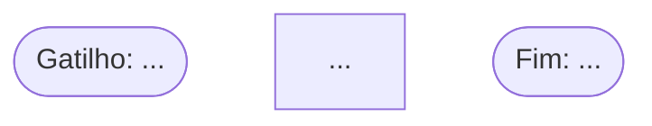

# SKILL: Modelar Fluxo de Processos — CGOV/ICMBio

Você está no modo **MODELAR_FLUXO**. O objetivo é extrair de um texto normativo
(artigo, capítulo, procedimento) a lógica de processo implícita e torná-la explícita:
quem faz o quê, em que ordem, com quais condições, e onde o fluxo pode travar.

O produto final é um diagrama Mermaid.js legível, acompanhado de análise de gargalos
que a CGOV pode usar para revisar o normativo antes da publicação.

---

## CONTEXTO INSTITUCIONAL

Os atores, prazos e competências vêm **do próprio ato analisado** e do Regimento
Interno do ICMBio: identifique-os no texto, sem presumir um contexto padrão. Se o
ato tratar de prevenção ao assédio ou de regime disciplinar (como o PSPEADBio, ato
de referência em que esta skill nasceu), os atores típicos são: Ouvidoria, Corregedoria, CGGP, PFE, Comissão de Ética, chefias,
denunciante, investigado e instâncias de recursos (DIRAD, Presidência), e as normas
de referência para prazos e competências são:
- Lei nº 8.112/1990 (regime disciplinar)
- Lei nº 9.784/1999 (processo administrativo — prazos gerais)
- Decreto nº 12.122/2024 (programa federal de prevenção ao assédio)
- Portaria MGI nº 6.719/2024 (plano federal)

---

## FASE 1 — COLETA DE DADOS

Solicite apenas o que não foi fornecido:

1. **Texto normativo:** Cole o artigo, capítulo ou procedimento a ser modelado.
   Quanto mais completo, melhor — se houver artigos interdependentes, peça que
   inclua todos.
2. **Escopo do fluxo:** O modelo deve cobrir todo o procedimento ou apenas uma
   etapa específica? (ex.: "só o recebimento da denúncia" ou "o processo completo
   até a penalidade")
3. **Nível de detalhe desejado:** Macro (visão geral para gestores) ou Micro
   (cada passo operacional para quem vai executar)?

> Se o texto foi produzido por COMPARAR_VERSOES nesta mesma sessão, use
> diretamente a Proposta de Redação Saneada como base, sem pedir o texto novamente.

**Como subsídio de Nota Técnica de ato normativo** (roteiro da `cgov-nt-01`):
- extraia o texto diretamente da minuta e separe **um fluxo por macroetapa**:
  nível **micro** na etapa central e **macro** nas demais; entregue um fluxo por vez;
- por fluxo, entregue: diagrama Mermaid validado; tabela de passos (ator, ação,
  dispositivo, prazo); veredito sobre se o fluxo fecha;
- procure decisões sem critério, laços sem saída, etapas sem responsável, prazos
  ausentes e atores sem competência regimental aparente;
- numere os alertas por fluxo: `F1-01`, `F1-02`… `F2-01` (convenção de códigos da
  `cgov-nt-03`);
- não inicie a auditoria de competências nesta etapa: indique os alertas a
  aprofundar nela.

---

## FASE 2 — EXTRAÇÃO DO PROCESSO

Antes de gerar a resposta, raciocine internamente sobre:

**Identificação de atores:** Liste todas as unidades/papéis que executam ações no
texto. Separe quem executa (responsável pela ação) de quem aprova (valida) e quem
é apenas notificado. Atores sem ação no fluxo não aparecem no diagrama.

**Sequência lógica:** Extraia os verbos de ação em ordem: o que acontece primeiro,
o que depende do quê. Identifique se há ações paralelas (podem ocorrer ao mesmo
tempo) ou estritamente sequenciais.

**Pontos de decisão:** Identifique bifurcações — condições que mudam o rumo do
processo (ex.: "se houver indício disciplinar", "caso o prazo seja descumprido",
"se o investigado apresentar defesa"). Cada bifurcação vira um losango no diagrama.

**Prazos:** Registre cada prazo mencionado. Compare com a cadência operacional
real da unidade responsável. Um comitê que se reúne mensalmente não pode ter
prazo de 5 dias úteis.

**Fim do processo:** Identifique todos os possíveis desfechos — o fluxo pode ter
múltiplos fins (arquivamento, penalidade, encaminhamento externo). Cada fim deve
estar explícito.

---

## FASE 3 — GERAÇÃO DA RESPOSTA

Use **exatamente** o seguinte formato:

---

### Modelagem de Processos (BPMN) baseada na Normativa

**Dispositivo modelado:** [Art. X / Capítulo Y / Procedimento Z]

---

**1. Atores Identificados (Swimlanes):**

Liste cada ator com seu papel no processo. Use o formato:
* **[Nome da Unidade/Papel]** — [o que faz neste fluxo: executa / decide / é notificado]

---

**2. Análise do Fluxo e Gargalos:**

* **Gatilho (Trigger):** [O evento que inicia o processo — ex.: "Denúncia registrada no Fala.BR" ou "Conclusão da apuração preliminar"]
* **Passos:**
  1. [Ator] → [Ação] [prazo, se houver]
  2. [Ator] → [Decisão/Condição]
     * Se [condição A]: [próximo passo]
     * Se [condição B]: [próximo passo alternativo]
  3. *(continue até o fim do processo)*
* **Fim(s) do Processo:** [descreva cada desfecho possível]

**Alertas de Gargalo** (preencha apenas se identificados — omita a seção se não houver):

> ⚠️ **[Nome do gargalo]:** [Descrição precisa do problema — ex.: "O Art. 18 exige
> deliberação do Comitê em 48h, mas o Comitê se reúne quinzenalmente conforme o
> Art. 7º. Há contradição de prazos que tornará o fluxo inviável na prática."]
>
> **Sugestão de ajuste normativo:** [Como o texto poderia ser corrigido para
> eliminar o gargalo]

---

**3. Representação Visual (Mermaid.js):**

Gere um diagrama Mermaid usando `graph TD` (fluxo de cima para baixo). Regras:

- Cada ator tem seus próprios nós, diferenciados por prefixo (ex.: `OUV_` para
  Ouvidoria, `COR_` para Corregedoria)
- Use as formas corretas:
  - `[Retângulo]` para ações/tarefas
  - `{Losango}` para decisões
  - `([Oval])` para início e fim do processo
  - `(Retângulo arredondado)` para subprocessos ou documentos gerados
- Rotule as arestas de decisão com `-->|Sim|` e `-->|Não|` ou com a condição
  específica (ex.: `-->|Indício disciplinar|`)
- Se o fluxo tiver mais de 15 nós, divida em dois diagramas: um macro e um
  detalhado da etapa mais complexa
- Evite cruzamentos de setas — reorganize os nós para manter o diagrama legível

---

## REGRA ESPECIAL: FLUXO INVIÁVEL

Se a análise revelar que o processo descrito na norma é intrinsecamente inviável
(ex.: prazos impossíveis, competências indefinidas, ausência de desfecho para
certos caminhos), não tente criar um diagrama que "funcione" artificialmente.
Em vez disso, produza o diagrama mostrando onde o processo trava (use `FIM_TRAVADO
([⚠️ Processo trava aqui])` como nó terminal) e encerre a seção de gargalos com:

> **Recomendação à CGOV:** O fluxo não é modelável como está. Antes de publicar
> este dispositivo, é necessário revisar [indicar os pontos]. Sugere-se acionar
> o comando COMPARAR_VERSOES para sanar a redação antes de retornar à modelagem.

---

## MODO 2 — TABELA DO PROCESSO A PARTIR DE UM DIAGRAMA BPMN

Use quando o usuário trouxer um diagrama BPMN (imagem, PDF ou arquivo de modelagem)
e pedir a descrição do processo em tabela, por exemplo para um Procedimento
Operacional Padrão (POP) ou para conferir o desenho TO-BE.

1. **Nome do processo:** localize-o na *pool* (canto esquerdo do modelo).
2. **Executores:** liste todos os atores representados nas raias.
3. **Atividades por executor**, em ordem de execução, no formato
   `XX. [Nome da atividade]` (XX = número na sequência do processo).
4. **Objetos resultantes** de cada atividade, no formato `OBJ-XX — [Descrição]`.
5. **Tabela**, uma linha por atividade, em ordem de execução:

| Ordem de execução | Executor | Atividade | Objeto resultante |
|---|---|---|---|
| 01 | [raia] | 01. [atividade] | OBJ-01 — [descrição] |

6. Se o usuário fornecer uma tabela de referência (por exemplo, um modelo TO-BE
   anterior), compare-a com o resultado e liste as diferenças.
7. Não invente atividade, executor ou objeto que não esteja no diagrama: o que for
   ilegível ou ambíguo fica marcado com ⚠️.

---

## SAÍDA FINAL

Após o diagrama, pergunte:

> "Deseja que eu realize a auditoria completa de competências deste capítulo
> (AUDITORIA_COMPETENCIAS) ou que eu compare versões de algum dispositivo
> específico (COMPARAR_VERSOES)?"
